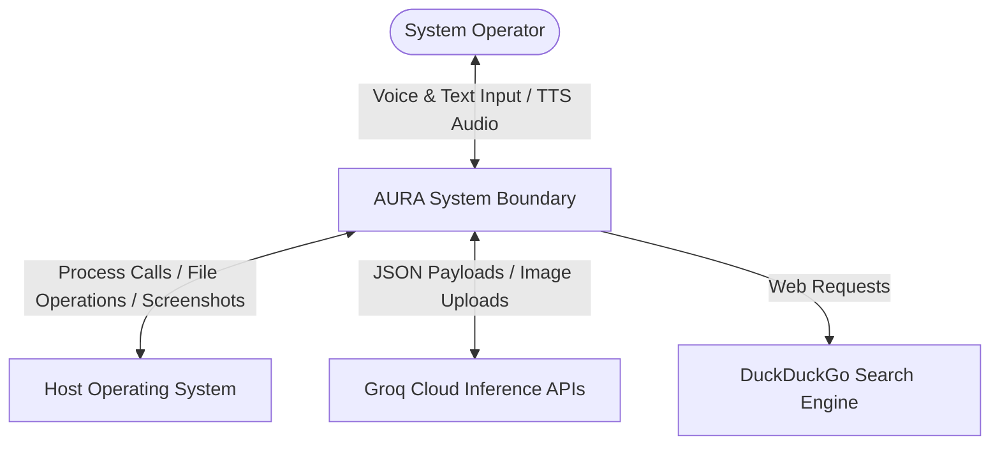
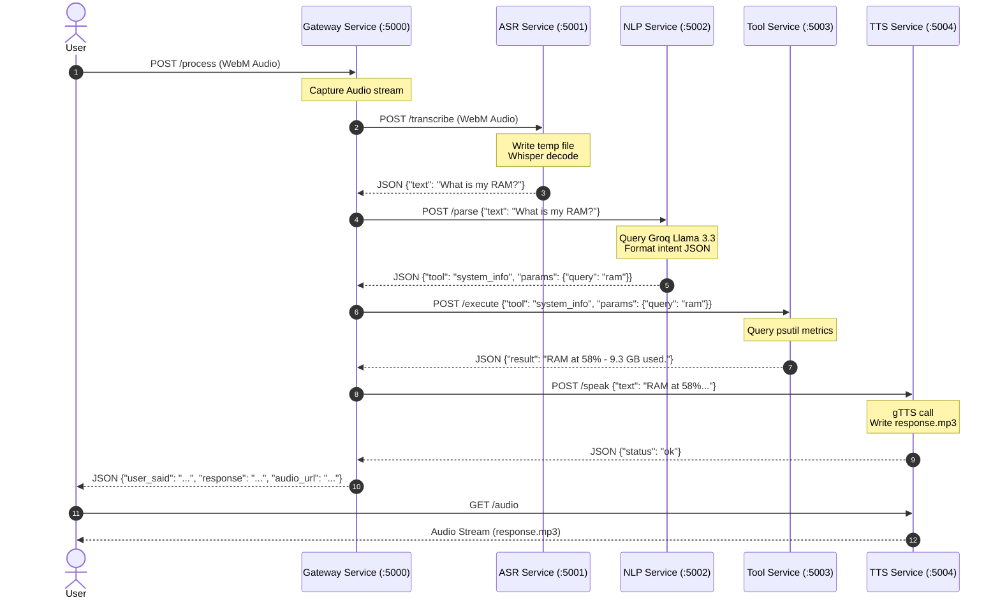
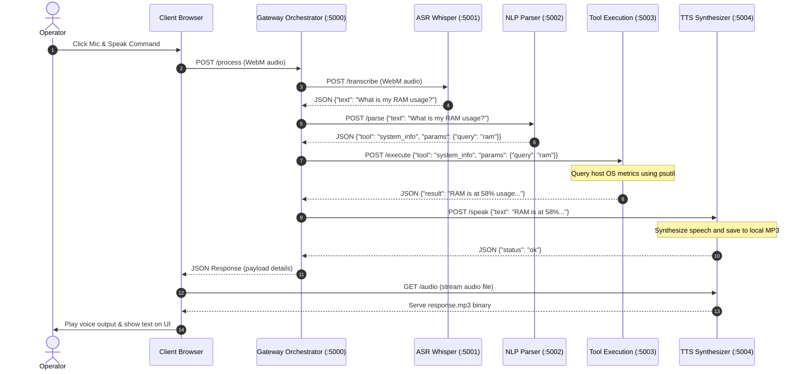
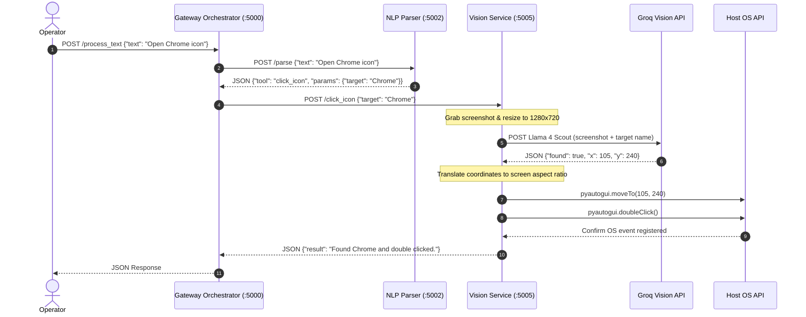
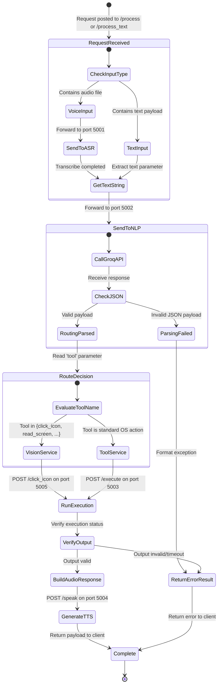

# AURA TECHNICAL SPECIFICATION DOCUMENT
## Software Requirements Specification (SRS) & System Design Document
---


## CHAPTER 1: INTRODUCTION & PROJECT OVERVIEW

---

### 1. Cover Page

**TITLE OF THE PROJECT**  
**AURA – A Microservice-Based Autonomous Universal Response Assistant for Voice-Driven Intelligent Desktop Automation**

**A Major Project Report / Technical Specification Document**  
Submitted in partial fulfillment of the requirements for the degree of  
**Bachelor of Technology (B.Tech) in Computer Science & Engineering**

**Submitted By:**  
Nitin (Roll No: BTECH-CSE-2026-N1)  

**Department of Computer Science & Engineering**  
**July 2026**  

---

### 2. Version History

The following table documents the revision history of this specification. All changes must be approved by the lead architect.

| Version | Date | Author | Description of Changes | Approved By |
| :--- | :--- | :--- | :--- | :--- |
| v0.1.0 | 2026-05-10 | Nitin | Initial project proposal and service layout diagram. | Academic Board |
| v1.0.0 | 2026-06-15 | Nitin | Initial microservice implementation (ASR, Gateway, Tools, TTS). | Technical Advisor |
| v2.0.0 | 2026-07-08 | Nitin | Integrated Vision capability (`llama-4-scout-17b`) and created `.env` routing. | Lead Architect |

---

### 3. Table of Contents

- **CHAPTER 1: INTRODUCTION & PROJECT OVERVIEW**
  - 1. Cover Page
  - 2. Version History
  - 3. Table of Contents
  - 4. Executive Summary
  - 5. Project Overview
  - 6. Problem Statement
  - 7. Objectives
  - 8. Scope
- **CHAPTER 2: EXISTING SYSTEM & USER SPECIFICATION**
  - 9. Existing System Analysis
  - 10. Proposed System
  - 11. System Overview
  - 12. Stakeholders
  - 13. User Roles
  - 14. User Requirements
- **CHAPTER 3: FUNCTIONAL REQUIREMENTS**
  - 15. Functional Requirements (FR-001 to FR-045)
- **CHAPTER 4: SYSTEM QUALITIES & OPERATIONAL RULES**
  - 16. Non-Functional Requirements
  - 17. Business Rules
  - 18. Assumptions
  - 19. Constraints
  - 20. Use Cases
  - 21. User Stories
  - 22. Acceptance Criteria
- **CHAPTER 5: SOFTWARE ARCHITECTURE & SERVICE DESIGN**
  - 23. System Context Diagram
  - 24. Software Architecture
  - 25. Microservice Architecture
  - 26. Component Diagram
  - 27. Service Responsibilities
  - 28. Gateway Service Design
  - 29. ASR Service Design
  - 30. NLP Service Design
  - 31. Tool Execution Service Design
  - 32. Vision Service Design
  - 33. Text-to-Speech Service Design
  - 34. Communication Flow
- **CHAPTER 6: REST API SPECIFICATIONS & BEHAVIORAL DIAGRAMS**
  - 35. REST API Specifications
  - 36. Sequence Diagrams
  - 37. Activity Diagrams
  - 38. State Diagrams
  - 39. Deployment Architecture
- **CHAPTER 7: SYSTEM IMPLEMENTATION & QUALITY ASSURANCE**
  - 40. Technology Stack
  - 41. Folder Structure
  - 42. Configuration Management
  - 43. Security Requirements
  - 44. Privacy Requirements
  - 45. Error Handling Strategy
  - 46. Logging Strategy
  - 47. Performance Requirements
  - 48. Scalability Considerations
  - 49. Reliability Requirements
  - 50. Availability Requirements
  - 51. Maintainability Requirements
  - 52. Extensibility Plan
- **CHAPTER 8: VERIFICATION, DEPLOYMENT & OPERATION**
  - 53. Testing Strategy
  - 54. Unit Testing
  - 55. Integration Testing
  - 56. System Testing
  - 57. Test Cases
  - 58. Deployment Guide
  - 59. Installation Guide
  - 60. Future Enhancements
  - 61. Risks and Limitations
  - 62. Glossary
  - 63. References

---

### 4. Executive Summary

AURA (Autonomous Universal Response Assistant) is a modern, voice-activated AI assistant running on a local microservices architecture. Designed for developers and power users, it automates common operating system interactions—such as file editing, media control, calendar scheduling, web search, active window management, and visual screen control—using natural language.

The application leverages a hybrid edge-cloud pipeline. An offline, local Whisper instance processes audio inputs, while complex semantic parsing and screen-image understanding are offloaded to cloud-hosted Large Language Models (LLMs) via the Groq API. Actions are executed locally on the host machine using low-level OS shell commands and coordinate-based mouse/keyboard simulations. By splitting these tasks into independent Flask microservices, AURA achieves modularity, fault tolerance, and a clear separation of concerns.

---

### 5. Project Overview

AURA is developed as a final year B.Tech project in Computer Science & Engineering. The project demonstrates the application of distributed systems engineering, computer vision, and machine learning to build an intelligent OS controller. 

Unlike traditional monolith voice applications, AURA decomposes the processing lifecycle into distinct stages:
1. **ASR (Speech-to-Text):** Runs locally via OpenAI's Whisper `base` model.
2. **NLP (Intent Parser):** Evaluates user instructions using `llama-3.3-70b-versatile` to produce JSON schemas representing commands.
3. **Orchestrator (Gateway):** Routes requests to specialized local services.
4. **Tools Executor:** Interacts with the local file system, process manager, and active application windows.
5. **Vision Service:** Captures the display buffer and uses `llama-4-scout-17b-16e-instruct` to perform visual search and mouse clicks.
6. **TTS (Text-to-Speech):** Converts text output back to audio streams for playback.

---

### 6. Problem Statement

Existing consumer-grade voice assistants (e.g., Apple Siri, Amazon Alexa, Google Assistant) are closed cloud ecosystems. They suffer from three core limitations:
1. **System Control Gaps:** They cannot perform fine-grained desktop automation, such as editing local text files, checking system RAM, launching specific developer tools, or clicking arbitrary screen locations.
2. **Privacy Vulnerabilities:** They continuously stream ambient voice capture and personal system metadata to centralized cloud servers.
3. **Rigid API Integrations:** They struggle to automate legacy or GUI-only desktop applications that lack public APIs or command-line developer hooks.

AURA addresses these issues by implementing a local microservices runtime that combines private local ASR with lightweight visual screen automation.

---

### 7. Objectives

#### Primary Objectives:
- Implement a functional, low-latency microservice pipeline that automates operating system tasks from voice and text inputs.
- Integrate a local Whisper ASR engine to handle speech-to-text without sending raw audio to cloud servers.
- Develop a vision-based GUI automation pipeline that allows the agent to locate and double-click interface elements by name.
- Maintain a clean separation of concerns by hosting services on dedicated local loopback ports.

#### Secondary Objectives:
- Provide an ambient, interactive user interface utilizing modern CSS layouts.
- Keep resource usage low on standard laptop hardware (under 2GB RAM overhead for the entire suite of services).
- Structure the codebase to allow developers to easily add custom Python tools.

---

### 8. Scope

#### In-Scope:
- **Local File System Operations:** Creating, reading, editing (append/overwrite), finding, and deleting files on the host PC.
- **System Monitoring:** Reading active RAM usage, CPU load, active windows, and battery status.
- **Process Orchestration:** Launching and closing common desktop applications (Chrome, Notepad, VS Code, Command Prompt).
- **GUI Control:** Capturing host screenshots, detecting visual icon coordinates, and executing click operations.
- **Web Search:** Fetching results from DuckDuckGo and reading summaries.

#### Out-of-Scope:
- Multi-user concurrency or user account synchronization.
- Voice biometric verification (speaker identification).
- Direct control of mobile operating systems (iOS/Android).
- Complex network vulnerability scanning.


---


## CHAPTER 2: EXISTING SYSTEM & USER SPECIFICATION

---

### 9. Existing System Analysis

Legacy desktop voice controllers typically fall into two categories: generic cloud assistants or basic scripting frameworks.

#### Cloud Assistants (Cortana, Siri, Google Assistant):
- **Architecture:** Cloud-centric, monolithic black boxes.
- **Vulnerabilities:**
  - **High Latency:** Raw audio data is sent over WAN to distant cloud servers, parsed, and sent back as text before any execution occurs.
  - **Telemetry and Privacy Risks:** Constant logging of user speech patterns, environment audio, and local system paths.
  - **No System Integration:** Security boundaries prevent these assistants from accessing the local shell or running arbitrary developer-defined script files.

#### Custom Scripting Frameworks (Siri Shortcuts, AutoHotkey, VoiceAttack):
- **Architecture:** Rule-based local macro systems.
- **Vulnerabilities:**
  - **Brittle Rule Matching:** Users must match commands *exactly* (e.g., "Open chrome" will succeed, but "Launch my web browser" will fail if not hardcoded).
  - **No Contextual Vision:** They cannot inspect screen contents to click dynamic elements without hardcoding absolute X/Y pixel coordinates.

---

### 10. Proposed System

AURA solves these limitations by implementing a local microservice architecture that combines local edge models with cloud LLMs.

```
                    ┌─────────────────────────┐
                    │  Browser UI (Port 5000) │
                    └────────────┬────────────┘
                                 │ HTTP / JSON
                                 ▼
                     ┌───────────────────────┐
                     │  Gateway Orchestrator │
                     └─────┬───────────┬─────┘
                           │           │
       ┌───────────────────┘           └───────────────────┐
       ▼ (Port 5001)                                       ▼ (Port 5002)
┌──────────────┐                                    ┌──────────────┐
│  ASR Service │                                    │  NLP Service │
│  (Whisper)   │                                    │   (Groq)     │
└──────────────┘                                    └──────────────┘
       │                                                   │
       ├───────────────────────────────────────────────────┤
       ▼ (Port 5003)                                       ▼ (Port 5005)
┌──────────────┐                                    ┌──────────────┐
│ Tool Service │                                    │Vision Service│
│ (OS Actions) │                                    │   (Groq)     │
└──────────────┘                                    └──────────────┘
       │                                                   │
       └───────────────────┬───────────────────────────────┘
                           ▼ (Port 5004)
                    ┌──────────────┐
                    │  TTS Service │
                    │    (gTTS)    │
                    └──────────────┘
```

#### Core Components of the Proposed Solution:
1. **Edge ASR:** Raw audio capture is processed entirely on the local loopback (`127.0.0.1:5001`) via Whisper, keeping audio files on the local machine.
2. **Context-Aware Intent Parsing:** High-performance LLMs parse commands into structured JSON dynamically, accommodating a wide range of natural phrasing.
3. **Multimodal GUI Control:** The Vision Service takes local screenshots and uses visual reasoning models to determine element locations, allowing AURA to interact with application interfaces.
4. **Independent Service Lifecycle:** If one service fails, the remaining infrastructure remains online.

---

### 11. System Overview

AURA operates by chaining specialized microservices via REST API calls. 

1. The frontend client (running in a local browser sandbox) records the user's voice input and POSTs it to the Gateway `/process` endpoint.
2. The Gateway forwards the binary audio payload to the ASR Service (`:5001/transcribe`), receiving a clean text string in response.
3. The transcribed text is sent to the NLP Service (`:5002/parse`), which returns a JSON payload detailing the target tool and required parameters.
4. If the intent requires visual reasoning, the Gateway routes the request to the Vision Service (`:5005`); otherwise, it targets the Tool Service (`:5003/execute`).
5. The selected service runs the command locally (e.g., creating a file or clicking an icon) and returns the text result.
6. The Gateway sends the text result to the TTS Service (`:5004/speak`) to generate an audio response, and then returns both the text output and audio URL back to the frontend.

---

### 12. Stakeholders

- **Student Evaluators / Project Coordinators:** Academics reviewing the system's software architecture, code quality, and engineering documentation.
- **Power Users / Developers:** Users seeking a hands-free, scriptable interface to control their local environment, manage files, and launch applications.
- **Accessibility Users:** Individuals with motor impairments who require reliable, voice-driven system control and visual screen reading.

---

### 13. User Roles

1. **System Operator (End-User):**
   - Interacts with the interface via voice or text input.
   - Grants permissions for high-risk operations.
   - Configures API keys and local settings.
2. **System Developer (Administrator):**
   - Adds custom tools to the Tool Service registry.
   - Monitors port configurations, logs, and system metrics.
   - Optimizes local model weights and execution environments.

---

### 14. User Requirements

- **Voice/Text Toggle:** The user must be able to switch between voice control and typed text input in the UI.
- **Low Latency:** The round-trip pipeline from voice command to execution must finish in under 3.5 seconds.
- **Hands-Free Verification:** The user must receive spoken and visual feedback confirming whether tasks succeeded or failed.
- **Data Privacy Control:** API keys must be stored in a local configuration file (`.env`), and no local audio clips should be sent to cloud storage.
- **System Stability:** Low-level OS execution should not crash the computer or overwrite critical system files.
- **GUI Control:** The system must allow users to click screen buttons and read active screen contents using natural language.


---


## CHAPTER 3: FUNCTIONAL REQUIREMENTS

---

### 15. Functional Requirements (FR-001 to FR-045)

#### FR-001: Web Browser Audio Recording
- **Requirement ID:** FR-001
- **Name:** Web Browser Audio Recording
- **Description:** The system must capture raw user audio using the Web Audio API in the browser.
- **Priority:** High
- **Inputs:** User voice via microphone.
- **Outputs:** Compressed audio stream (WebM/WAV format).
- **Preconditions:** Microphone permissions granted to `localhost:5000`.
- **Postconditions:** Audio file is buffered in browser memory.
- **Success Criteria:** Browser records and compresses audio without data loss.
- **Failure Conditions:** Audio device busy or permission denied, throwing a console error.

#### FR-002: Audio Transmission to Gateway
- **Requirement ID:** FR-002
- **Name:** Audio Transmission to Gateway
- **Description:** The client must POST the recorded audio file to the Gateway service.
- **Priority:** High
- **Inputs:** WebM audio payload.
- **Outputs:** HTTP 200 JSON response containing transcription and execution results.
- **Preconditions:** Gateway server is running on port 5000.
- **Postconditions:** Request payload is received by the Flask app.
- **Success Criteria:** Gateway receives the binary audio payload.
- **Failure Conditions:** Network timeout or Gateway offline, resulting in an HTTP 504.

#### FR-003: Local ASR Transcribe Request
- **Requirement ID:** FR-003
- **Name:** Local ASR Transcribe Request
- **Description:** The Gateway must forward the raw audio stream to the ASR Service.
- **Priority:** High
- **Inputs:** HTTP multipart file payload containing WebM audio.
- **Outputs:** JSON string containing the transcribed text: `{"text": "..."}`.
- **Preconditions:** ASR Service is active on port 5001.
- **Postconditions:** ASR receives and writes the stream to a temporary location.
- **Success Criteria:** Transcription is returned successfully to the Gateway.
- **Failure Conditions:** ASR service is unreachable, returning an HTTP 500.

#### FR-004: Whisper Audio Extraction
- **Requirement ID:** FR-004
- **Name:** Whisper Audio Extraction
- **Description:** The ASR service must convert input audio files to compatible formats and load them into Whisper.
- **Priority:** High
- **Inputs:** Temporary `.webm` audio file.
- **Outputs:** Transcribed English string.
- **Preconditions:** FFmpeg is installed and accessible in the system environment PATH.
- **Postconditions:** Whisper base model transcribes the speech.
- **Success Criteria:** FFmpeg processes the audio and Whisper extracts the text.
- **Failure Conditions:** FFmpeg is missing, causing a `FileNotFoundError` in Python.

#### FR-005: ASR Temporary File Cleanup
- **Requirement ID:** FR-005
- **Name:** ASR Temporary File Cleanup
- **Description:** The ASR service must delete temporary audio files immediately after transcription.
- **Priority:** Medium
- **Inputs:** Path to the temporary `.webm` file.
- **Outputs:** Filesystem status (success/failure code).
- **Preconditions:** File write operation completed.
- **Postconditions:** Temporary audio file is deleted.
- **Success Criteria:** OS reports successful deletion of the file.
- **Failure Conditions:** File permission locks prevent deletion, leaving orphaned files.

#### FR-006: NLP Intent Parser Routing
- **Requirement ID:** FR-006
- **Name:** NLP Intent Parser Routing
- **Description:** The Gateway must POST the transcribed text to the NLP service to extract intents and parameters.
- **Priority:** High
- **Inputs:** Plaintext string `{"text": "..."}`.
- **Outputs:** JSON object `{"intent": "...", "tool": "...", "params": {...}}`.
- **Preconditions:** NLP Service is active on port 5002.
- **Postconditions:** Clean structured payload returned to the Gateway.
- **Success Criteria:** Gateway receives correct JSON structure.
- **Failure Conditions:** NLP Service is down, returning an HTTP 500 connection error.

#### FR-007: Groq LLM Connection
- **Requirement ID:** FR-007
- **Name:** Groq LLM Connection
- **Description:** The NLP service must connect to the Groq API using the key specified in the environment variables.
- **Priority:** High
- **Inputs:** API Key `GROQ_API_KEY`, System Prompt, User Prompt.
- **Outputs:** Chat completion response payload.
- **Preconditions:** Active internet connection and valid key inside the `.env` file.
- **Postconditions:** Groq returns the chat completion payload.
- **Success Criteria:** API returns an HTTP 200 with model choices.
- **Failure Conditions:** Invalid API key or network down, returning an HTTP 401/403 or network timeout.

#### FR-008: Intent Schema Validation
- **Requirement ID:** FR-008
- **Name:** Intent Schema Validation
- **Description:** The NLP service must validate the JSON returned by the LLM against the system capability schema.
- **Priority:** High
- **Inputs:** Raw string response from LLM.
- **Outputs:** Validated JSON structure.
- **Preconditions:** LLM completes its response generation.
- **Postconditions:** JSON is loaded into a Python dictionary.
- **Success Criteria:** Parser successfully parses the response as JSON.
- **Failure Conditions:** LLM returns Markdown or text, causing a JSON decoding error.

#### FR-009: NLP Fallback Routing
- **Requirement ID:** FR-009
- **Name:** NLP Fallback Routing
- **Description:** If the user input does not match any register tool, the NLP service must route the query to a general conversational handler.
- **Priority:** Medium
- **Inputs:** Conversation text string.
- **Outputs:** JSON object with `"intent": "general"` and `"tool": "general"`.
- **Preconditions:** LLM response contains no tool structure.
- **Postconditions:** Action is routed to a general chat handler.
- **Success Criteria:** General response text returned correctly.
- **Failure Conditions:** Routing fails, causing a blank response.

#### FR-010: Create File Tool
- **Requirement ID:** FR-010
- **Name:** Create File Tool
- **Description:** The Tool Service must create a file at the specified location with optional initial content.
- **Priority:** High
- **Inputs:** File path, content string.
- **Outputs:** Execution status: `{"status": "success", "result": "..."}`.
- **Preconditions:** Target folder exists and has write permissions.
- **Postconditions:** File is created on the filesystem.
- **Success Criteria:** The file exists and contains the specified content.
- **Failure Conditions:** Directory path not found or permissions denied, returning an error message.

#### FR-011: Read File Tool
- **Requirement ID:** FR-011
- **Name:** Read File Tool
- **Description:** The Tool Service must open and read the contents of a local file.
- **Priority:** High
- **Inputs:** Absolute or relative file path.
- **Outputs:** Plaintext file contents.
- **Preconditions:** Target file exists and has read permissions.
- **Postconditions:** File handle is closed.
- **Success Criteria:** System successfully reads and returns the file contents.
- **Failure Conditions:** File not found, returning an error message.

#### FR-012: Edit File Tool
- **Requirement ID:** FR-012
- **Name:** Edit File Tool
- **Description:** The Tool Service must edit an existing file, supporting overwrite or append operations.
- **Priority:** High
- **Inputs:** Target path, content string, edit mode ("overwrite" or "append").
- **Outputs:** Success status message.
- **Preconditions:** File exists and is writeable.
- **Postconditions:** File content is updated.
- **Success Criteria:** New text is written to the file.
- **Failure Conditions:** Disk full or write permission denied.

#### FR-013: Delete File Tool
- **Requirement ID:** FR-013
- **Name:** Delete File Tool
- **Description:** The Tool Service must delete a file from the host filesystem.
- **Priority:** High
- **Inputs:** File path.
- **Outputs:** Deletion confirmation message.
- **Preconditions:** Target file exists.
- **Postconditions:** File is removed from disk.
- **Success Criteria:** File no longer exists on disk.
- **Failure Conditions:** File lock or permission denied.

#### FR-014: Global File Search
- **Requirement ID:** FR-014
- **Name:** Global File Search
- **Description:** The Tool Service must search for a file by name across common user directories.
- **Priority:** Medium
- **Inputs:** Target filename.
- **Outputs:** List of absolute file paths matching the query.
- **Preconditions:** Directory indexes are readable.
- **Postconditions:** Return matching file paths.
- **Success Criteria:** Target file is located.
- **Failure Conditions:** Zero matches found, returning "file not found".

#### FR-015: Directory Listing Tool
- **Requirement ID:** FR-015
- **Name:** Directory Listing Tool
- **Description:** The Tool Service must list all files and subdirectories inside a specified folder.
- **Priority:** Medium
- **Inputs:** Target directory path.
- **Outputs:** JSON list containing file names and directory properties.
- **Preconditions:** Target directory exists.
- **Postconditions:** Return listing payload.
- **Success Criteria:** Files inside folder are listed correctly.
- **Failure Conditions:** Access denied or folder missing.

#### FR-016: Local System RAM Query
- **Requirement ID:** FR-016
- **Name:** Local System RAM Query
- **Description:** The Tool Service must read the host system's RAM utilization metrics.
- **Priority:** Medium
- **Inputs:** None.
- **Outputs:** Used/Total RAM capacity metrics (e.g., "RAM at 58%").
- **Preconditions:** `psutil` library is initialized.
- **Postconditions:** Read complete.
- **Success Criteria:** Current RAM status returned.
- **Failure Conditions:** Access violation reading system statistics.

#### FR-017: CPU Load Query
- **Requirement ID:** FR-017
- **Name:** CPU Load Query
- **Description:** The Tool Service must retrieve the current CPU utilization percentage.
- **Priority:** Medium
- **Inputs:** None.
- **Outputs:** Overall CPU load percentage.
- **Preconditions:** System API access is available.
- **Postconditions:** Return stats.
- **Success Criteria:** Average CPU load returned.
- **Failure Conditions:** Library metrics failure.

#### FR-018: Host Battery Status
- **Requirement ID:** FR-018
- **Name:** Host Battery Status
- **Description:** The Tool Service must query the battery level and charging state of the host device.
- **Priority:** Low
- **Inputs:** None.
- **Outputs:** Battery percentage and power plug status.
- **Preconditions:** Power APIs are available on the OS.
- **Postconditions:** Returns battery status payload.
- **Success Criteria:** Correct percentage returned.
- **Failure Conditions:** Device has no battery (e.g., desktop PC), returning "Not available".

#### FR-019: Open Application Tool
- **Requirement ID:** FR-019
- **Name:** Open Application Tool
- **Description:** The Tool Service must launch a designated desktop application via system execution hooks.
- **Priority:** High
- **Inputs:** Target application name or process path.
- **Outputs:** Process ID (PID) or launch confirmation message.
- **Preconditions:** Application path is registered in system environment.
- **Postconditions:** Application runs as a background process.
- **Success Criteria:** Application window opens.
- **Failure Conditions:** Application path is not found in Registry/PATH, returning an error.

#### FR-020: Close Application Tool
- **Requirement ID:** FR-020
- **Name:** Close Application Tool
- **Description:** The Tool Service must terminate running process instances of an application.
- **Priority:** High
- **Inputs:** Application process name (e.g., "chrome.exe").
- **Outputs:** Process termination confirmation message.
- **Preconditions:** Target process is active.
- **Postconditions:** Process is terminated.
- **Success Criteria:** Target application window closes.
- **Failure Conditions:** Access denied or process not running.

#### FR-021: System Volume Adjustment
- **Requirement ID:** FR-021
- **Name:** System Volume Adjustment
- **Description:** The Tool Service must adjust the system master volume level.
- **Priority:** Medium
- **Inputs:** Action ("up", "down", "mute"), amount value.
- **Outputs:** Updated volume status message.
- **Preconditions:** System audio driver is active.
- **Postconditions:** Output volume changes.
- **Success Criteria:** Host system volume adjusts.
- **Failure Conditions:** Audio device not detected.

#### FR-022: Active Windows Listing
- **Requirement ID:** FR-022
- **Name:** Active Windows Listing
- **Description:** The Tool Service must list the titles of all active application windows.
- **Priority:** Medium
- **Inputs:** None.
- **Outputs:** List of active window titles.
- **Preconditions:** `pygetwindow` library is loaded.
- **Postconditions:** List generated.
- **Success Criteria:** Return names of open windows.
- **Failure Conditions:** OS window manager refuses access.

#### FR-023: Window State Manipulation
- **Requirement ID:** FR-023
- **Name:** Window State Manipulation
- **Description:** The Tool Service must minimize, maximize, or focus a designated application window.
- **Priority:** Medium
- **Inputs:** Target window title, action ("minimize", "maximize", "focus").
- **Outputs:** Action confirmation status.
- **Preconditions:** Target window exists.
- **Postconditions:** Window layout changes.
- **Success Criteria:** Selected window changes layout state.
- **Failure Conditions:** Window title not located.

#### FR-024: Web Search Query
- **Requirement ID:** FR-024
- **Name:** Web Search Query
- **Description:** The Tool Service must perform a search query using DuckDuckGo and parse the results.
- **Priority:** High
- **Inputs:** Search query string.
- **Outputs:** Consolidated list of search results.
- **Preconditions:** Internet connection is active.
- **Postconditions:** Connection closed.
- **Success Criteria:** DuckDuckGo returns search snippets.
- **Failure Conditions:** Connection timeout or API blocked.

#### FR-025: Calendar Log Writer
- **Requirement ID:** FR-025
- **Name:** Calendar Log Writer
- **Description:** The Tool Service must log scheduled events to the local `calendar.csv` file.
- **Priority:** Medium
- **Inputs:** Event title, date, time string.
- **Outputs:** Success confirmation message.
- **Preconditions:** Write access to the storage directory.
- **Postconditions:** CSV row is written.
- **Success Criteria:** Event is written to the CSV file.
- **Failure Conditions:** CSV file locked by another application.

#### FR-026: Desktop Screenshot Grabber
- **Requirement ID:** FR-026
- **Name:** Desktop Screenshot Grabber
- **Description:** The Vision Service must capture the desktop frame buffer and save it to disk.
- **Priority:** High
- **Inputs:** Screen region bounding box.
- **Outputs:** Base64 image payload and a local PNG file.
- **Preconditions:** Desktop environment is active (not locked or headless).
- **Postconditions:** File is written to the vision folder.
- **Success Criteria:** Frame buffer is saved as a 720p PNG.
- **Failure Conditions:** Screen device context unavailable (e.g., system locked).

#### FR-027: Screen Resize and Compression
- **Requirement ID:** FR-027
- **Name:** Screen Resize and Compression
- **Description:** The Vision Service must compress the captured screenshot to reduce token usage.
- **Priority:** Medium
- **Inputs:** Original raw image.
- **Outputs:** Resized 1280x720 PNG image.
- **Preconditions:** Image successfully captured.
- **Postconditions:** Compressed image is loaded into memory.
- **Success Criteria:** File size reduced by at least 70%.
- **Failure Conditions:** Image compression library throws an error.

#### FR-028: Vision Model Request
- **Requirement ID:** FR-028
- **Name:** Vision Model Request
- **Description:** The Vision Service must upload the base64-encoded screenshot and query the multimodal model.
- **Priority:** High
- **Inputs:** Base64 image payload, prompt text.
- **Outputs:** Model response text.
- **Preconditions:** Valid Groq API key configured.
- **Postconditions:** Completion received.
- **Success Criteria:** Groq returns a description or parsed coordinate JSON.
- **Failure Conditions:** Upload timeout or API rate limit exceeded.

#### FR-029: Screen Coordinate Extraction
- **Requirement ID:** FR-029
- **Name:** Screen Coordinate Extraction
- **Description:** The Vision Service must locate the coordinates of a target element on screen.
- **Priority:** High
- **Inputs:** Target element name.
- **Outputs:** JSON object: `{"found": true, "x": 123, "y": 456}`.
- **Preconditions:** Vision model processes the screenshot.
- **Postconditions:** Coordinates are parsed.
- **Success Criteria:** System returns valid pixel coordinates.
- **Failure Conditions:** Model returns non-JSON or invalid coordinates.

#### FR-030: Screen Coordinate Translation
- **Requirement ID:** FR-030
- **Name:** Screen Coordinate Translation
- **Description:** The Vision Service must scale coordinates from 1280x720 back to the host system's resolution.
- **Priority:** High
- **Inputs:** Normalized X and Y coordinates.
- **Outputs:** Target system coordinates.
- **Preconditions:** `pyautogui.size()` returns screen dimensions.
- **Postconditions:** Coordinates are converted.
- **Success Criteria:** Target coordinates match the display aspect ratio.
- **Failure Conditions:** Output out of bounds.

#### FR-031: Simulated Mouse Movement
- **Requirement ID:** FR-031
- **Name:** Simulated Mouse Movement
- **Description:** The Vision Service must move the host mouse cursor to target coordinates.
- **Priority:** High
- **Inputs:** Screen X and Y coordinates.
- **Outputs:** None.
- **Preconditions:** Target location is within screen bounds.
- **Postconditions:** Mouse cursor position updates.
- **Success Criteria:** Cursor moves to the target element.
- **Failure Conditions:** PyAutoGUI failsafe is triggered.

#### FR-032: Simulated Click Execution
- **Requirement ID:** FR-032
- **Name:** Simulated Click Execution
- **Description:** The Vision Service must execute a click or double-click action at current coordinates.
- **Priority:** High
- **Inputs:** Action type ("single_click" or "double_click").
- **Outputs:** Success status message.
- **Preconditions:** Mouse cursor is positioned over the target.
- **Postconditions:** OS registers a click event.
- **Success Criteria:** Application element is clicked or opened.
- **Failure Conditions:** Target application window is unresponsive.

#### FR-033: Screen Description
- **Requirement ID:** FR-033
- **Name:** Screen Description
- **Description:** The Vision Service must describe the user's active desktop screen in detail.
- **Priority:** Medium
- **Inputs:** Question prompt.
- **Outputs:** Text description of desktop contents.
- **Preconditions:** Screenshot successfully captured.
- **Postconditions:** Returns description.
- **Success Criteria:** Returns description of open windows and icons.
- **Failure Conditions:** Vision model parsing fails.

#### FR-034: Desktop Icons Scanner
- **Requirement ID:** FR-034
- **Name:** Desktop Icons Scanner
- **Description:** The Vision Service must list all active files and folders visible on the desktop.
- **Priority:** Medium
- **Inputs:** None.
- **Outputs:** List of files and folders.
- **Preconditions:** Read access to Desktop directory.
- **Postconditions:** Return list.
- **Success Criteria:** Return file list matching visual desktop state.
- **Failure Conditions:** Directory read error.

#### FR-035: Find Text on Screen
- **Requirement ID:** FR-035
- **Name:** Find Text on Screen
- **Description:** The Vision Service must search for specific text visible on the user's screen.
- **Priority:** Medium
- **Inputs:** Target text query.
- **Outputs:** Approximate coordinate layout of matched text.
- **Preconditions:** Screenshot successfully captured.
- **Postconditions:** Return location.
- **Success Criteria:** Target text is located on screen.
- **Failure Conditions:** Text not found.

#### FR-036: TTS Speak Request
- **Requirement ID:** FR-036
- **Name:** TTS Speak Request
- **Description:** The Gateway must send response text to the TTS service to generate an audio file.
- **Priority:** High
- **Inputs:** Plaintext response payload.
- **Outputs:** Status code `{"status": "ok"}`.
- **Preconditions:** TTS service is active on port 5004.
- **Postconditions:** Audio file is saved to disk.
- **Success Criteria:** TTS creates the target audio file.
- **Failure Conditions:** TTS engine returns an error.

#### FR-037: TTS Audio File Generation
- **Requirement ID:** FR-037
- **Name:** TTS Audio File Generation
- **Description:** The TTS service must generate an MP3 audio file using Google Text-to-Speech (gTTS).
- **Priority:** High
- **Inputs:** Plaintext string.
- **Outputs:** `response.mp3` saved on disk.
- **Preconditions:** Active internet connection to Google translate servers.
- **Postconditions:** Audio file is written.
- **Success Criteria:** MP3 file exists on disk.
- **Failure Conditions:** Connection timeout.

#### FR-038: TTS Audio Fetch
- **Requirement ID:** FR-038
- **Name:** TTS Audio Fetch
- **Description:** The Gateway must expose a static route to serve the generated MP3 file to the client.
- **Priority:** High
- **Inputs:** HTTP GET to `/audio`.
- **Outputs:** MP3 audio file stream.
- **Preconditions:** `response.mp3` exists.
- **Postconditions:** Audio stream sent.
- **Success Criteria:** Client browser plays the audio payload.
- **Failure Conditions:** Audio file missing on disk.

#### FR-039: Gateway Status API
- **Requirement ID:** FR-039
- **Name:** Gateway Status API
- **Description:** The Gateway must query the status of all microservices and return their online/offline state.
- **Priority:** Medium
- **Inputs:** None.
- **Outputs:** JSON list of service states.
- **Preconditions:** Services are configured on defined ports.
- **Postconditions:** Connection status returned.
- **Success Criteria:** Dashboard displays correct status of each service.
- **Failure Conditions:** Timeout occurs checking ports.

#### FR-040: Text Mode Routing
- **Requirement ID:** FR-040
- **Name:** Text Mode Routing
- **Description:** The Gateway must process text-only prompts, bypassing the ASR transcription step.
- **Priority:** High
- **Inputs:** Text string `{"text": "..."}`.
- **Outputs:** JSON response containing the execution result.
- **Preconditions:** Gateway is active on port 5000.
- **Postconditions:** Command is routed to the NLP Service.
- **Success Criteria:** Execution result is returned directly to the client.
- **Failure Conditions:** Invalid request format.

#### FR-041: Command Pre-Verification Guard
- **Requirement ID:** FR-041
- **Name:** Command Pre-Verification Guard
- **Description:** The system must validate user commands to prevent execution of unauthorized system operations.
- **Priority:** High
- **Inputs:** Intent data payload.
- **Outputs:** Boolean status (authorized/blocked).
- **Preconditions:** NLP successfully parses intent.
- **Postconditions:** Proceed to route task or abort execution.
- **Success Criteria:** System blocks unauthorized commands.
- **Failure Conditions:** Validation engine fails.

#### FR-042: Self-Verification of File Operations
- **Requirement ID:** FR-042
- **Name:** Self-Verification of File Operations
- **Description:** The Tool Service must verify that file modifications were successfully written to disk.
- **Priority:** Medium
- **Inputs:** Target file path.
- **Outputs:** Status check confirmation.
- **Preconditions:** Write operation completes.
- **Postconditions:** Return status.
- **Success Criteria:** System verifies file size or content updates.
- **Failure Conditions:** Verification fails.

#### FR-043: Static Asset Serving
- **Requirement ID:** FR-043
- **Name:** Static Asset Serving
- **Description:** The Gateway service must serve static frontend files (HTML, CSS, JS) from the local directory.
- **Priority:** High
- **Inputs:** HTTP GET requests.
- **Outputs:** HTML, CSS, JS source code files.
- **Preconditions:** Gateway service starts.
- **Postconditions:** Frontend resources loaded in browser.
- **Success Criteria:** Client browser displays the landing page.
- **Failure Conditions:** Missing static folder directory.

#### FR-044: Centralized Error Formatting
- **Requirement ID:** FR-044
- **Name:** Centralized Error Formatting
- **Description:** The Gateway must catch exceptions from all services and return standard error messages to the client.
- **Priority:** Medium
- **Inputs:** Python exception trace stack.
- **Outputs:** JSON error format: `{"error": "...", "response": "..."}`.
- **Preconditions:** Exception occurs during execution.
- **Postconditions:** System state remains stable.
- **Success Criteria:** UI shows a clear error message instead of crashing.
- **Failure Conditions:** Global try-except block fails.

#### FR-045: Execution Timeout Guard
- **Requirement ID:** FR-045
- **Name:** Execution Timeout Guard
- **Description:** The Gateway must abort execution and return a timeout message if a service does not respond within a set limit.
- **Priority:** Medium
- **Inputs:** HTTP request thread.
- **Outputs:** HTTP 504 gateway timeout message.
- **Preconditions:** Gateway routes request.
- **Postconditions:** Unresponsive service connection terminated.
- **Success Criteria:** System stays responsive to new requests.
- **Failure Conditions:** Infinite wait locks the thread pool.


---


## CHAPTER 4: SYSTEM QUALITIES & OPERATIONAL RULES

---

### 16. Non-Functional Requirements

#### Performance:
- **ASR Latency:** Voice transcribing on the local Whisper base service must complete within 1.5 seconds for audio clips under 5 seconds.
- **NLP Turnaround:** The intent parsing service must respond within 800 milliseconds.
- **UI Responsiveness:** The web-based dashboard must render message responses in under 200 milliseconds after receiving the Gateway payload.

#### Reliability:
- **ASR Error Tolerance:** The system must gracefully handle background noise, returning a fallback transcription string ("sorry I could not hear that") instead of crashing the process.
- **Failure Recovery:** If the Vision service or Tool service crashes, the Gateway must capture the exception and remain online to handle subsequent requests.

#### Security:
- **No Hardcoded Credentials:** The system must restrict the use of hardcoded keys, loading the `GROQ_API_KEY` from a local `.env` file.
- **Sandbox Boundary:** Low-level file actions must be restricted to user directories (Desktop, Documents, Downloads, Pictures) to prevent modification of critical OS directories.

#### Scalability:
- **Independent Scaling:** Since services run on individual ports, CPU-bound tasks like Whisper ASR and GPU-bound components can be scaled independently on separate hosts or Docker nodes.

#### Availability:
- **Local Availability:** When running offline, all core components (Gateway, ASR, Tools, TTS) must remain operational, disabling only cloud-dependent features (NLP, Vision, Web Search).

#### Maintainability:
- **Modularity:** Adding a new tool to the Tool service must require only writing a Python function and registering it in the intent mapping dictionary.

#### Usability:
- **Accessibility Support:** The interface must feature high-contrast modes, readable font scales (Syne, Instrument Serif, DM Mono), and real-time screen descriptions for visually impaired users.

#### Portability:
- **Cross-Platform Compatibility:** The codebase must run on Windows 10/11, macOS, and Linux configurations with minimal environment modifications.

#### Compatibility:
- **Python Compatibility:** The software must be fully compatible with Python versions 3.8 through 3.11.

#### Privacy:
- **On-Device Processing:** Raw audio recordings must be written, processed, and deleted locally, ensuring voice biometric data does not leave the host machine.

#### Accessibility:
- **Keyboard Access:** All UI actions must be accessible using standard keyboard navigation shortcuts (Tab, Enter).

#### Logging:
- **Central Log System:** Each service must output structured terminal logs detailing incoming requests, execution times, and status results.

#### Recovery:
- **State Reset:** If execution locks up or encounters an error, the user can reset the system state by clicking the central logo orb.

---

### 17. Business Rules

- **Voice commands must be validated before execution:** Intent parameters must be checked against system boundaries before calling python automation scripts.
- **Tool execution must occur only after successful intent recognition:** The execution service must reject payloads lacking a valid intent mapping.
- **Invalid commands must return clarification:** If the confidence of the NLP intent parser drops below a set threshold, it must ask the user for clarification.
- **Each microservice must be independently deployable:** Services must not have hard dependencies on shared libraries, using only REST endpoints to communicate.
- **Services communicate only through REST APIs:** No direct memory sharing or inter-process communication is permitted outside of standard HTTP requests.
- **Sensitive credentials must never be hardcoded:** Any required API keys must be loaded from local environment variables.
- **Voice responses must only be generated after successful task completion:** The TTS engine should only speak after the target action returns a status code.

---

### 18. Assumptions

- The host system has a functional microphone input configured at the OS level.
- The host system has active internet access to resolve cloud-based Groq API calls.
- The system shell running the python scripts has write access to the user's Desktop, Downloads, and Documents folders.
- FFmpeg is correctly installed and registered in the host system's PATH.

---

### 19. Constraints

- **Single-Threaded Execution:** Because PyAutoGUI takes control of the physical mouse cursor, only one visual clicking operation can run at any given time.
- **Hardware Limitations:** The local Whisper ASR service requires at least 2GB of free system memory to load model weights.
- **API Limits:** Groq API calls are subject to external rate limits (requests per minute and tokens per minute).

---

### 20. Use Cases

```
  ┌────────────────────────────────────────────────────────┐
  │ AURA System Boundary                                   │
  │                                                        │
  │                   ┌──────────────┐                     │
  │  ┌───────────────►│  Voice Input │                     │
  │  │                └──────────────┘                     │
  │  │                                                     │
  │  │                ┌──────────────┐                     │
  │  ├───────────────►│  File Action │                     │
  │  │                └──────────────┘                     │
  │  │                                                     │
  │  │                ┌──────────────┐                     │
  │  ├───────────────►│  System Info │◄─────────┐          │
  │  │                └──────────────┘          │          │
  │  │                                          │          │
  │  │                ┌──────────────┐          │          │
  │  ├───────────────►│ Vision Click │          │          │
  │  │                └──────────────┘          │          │
  │  │                                          │          │
  │  │                ┌──────────────┐          │          │
  │  └───────────────►│  Web Search  │          │          │
  │                   └──────────────┘          │          │
  │                                             │          │
  └─────────────────────────────────────────────┼──────────┘
                                                │
     ▲                                          ▲
     │                                          │
┌────┴────────┐                          ┌──────┴──────┐
│   User      │                          │ System APIs │
└─────────────┘                          └─────────────┘
```

#### Use Case UC-1: Perform System Action via Voice Command
- **Actor:** User
- **Description:** The user speaks a command to perform a system action (e.g., launching an application or checking RAM).
- **Flow of Events:**
  1. User clicks the microphone button and speaks: "What is my RAM usage?"
  2. The system records the voice input.
  3. The ASR service transcribes the audio to text.
  4. The NLP service parses the text and identifies the target tool (`system_info`).
  5. The Tool service runs the system check and retrieves RAM metrics.
  6. The system reads the results back to the user via TTS.

#### Use Case UC-2: Vision-Based Visual Automation
- **Actor:** User
- **Description:** The user asks AURA to open a application visible on the screen by name.
- **Flow of Events:**
  1. The user speaks: "Open Recycle Bin".
  2. The ASR service transcribes the command.
  3. The NLP service parses the command as a `click_icon` action with parameters `{"target": "Recycle Bin"}`.
  4. The Gateway routes the request to the Vision Service.
  5. The Vision Service captures a screenshot, downscales it to 720p, and sends it to the Groq vision API.
  6. The API returns the screen coordinates of the Recycle Bin icon.
  7. The Vision Service translates the coordinates and clicks the icon.

---

### 21. User Stories

1. **File Management:** "As a developer, I want to create and edit files using voice commands so that I can quickly log ideas without switching from my editor."
2. **Hands-Free System Info:** "As a system administrator, I want to check my system resource usage (RAM/CPU) using voice queries so that I can monitor system load while working on full-screen applications."
3. **Accessibility Assistance:** "As a user with limited motor function, I want to click screen buttons and control desktop windows using natural language, helping me navigate my computer without a physical mouse."

---

### 22. Acceptance Criteria

- **AC-1 (Voice Accuracy):** The system must transcribe voice inputs with at least 90% accuracy in quiet environments.
- **AC-2 (Execution Verification):** File creation commands must verify that the file exists on disk before returning a success message.
- **AC-3 (Fail-Safe Trigger):** In visual clicking tasks, if the target coordinates fall outside system bounds, the cursor must return to the center of the screen without executing clicks.
- **AC-4 (API Configuration):** The system must fail gracefully and notify the user if no valid `GROQ_API_KEY` is present in the configuration.


---


## CHAPTER 5: SOFTWARE ARCHITECTURE & SERVICE DESIGN

---

### 23. System Context Diagram

The System Context Diagram shows how AURA interacts with the user, the host operating system, and external cloud APIs.



---

### 24. Software Architecture

AURA is built on a distributed microservices architecture using local HTTP connections for communication. The core design focuses on **low-coupling** and **single-responsibility principles**. 

```
  ┌────────────────────────────────────────────────────────┐
  │                        GATEWAY                         │
  │                  (Routing Orchestrator)                │
  └──────────────────────────┬─────────────────────────────┘
                             │
            ┌────────────────┴────────────────┐
            ▼                                 ▼
    ┌───────────────┐                 ┌───────────────┐
    │  ASR SERVICE  │                 │  NLP SERVICE  │
    │ (Speech Edge) │                 │ (Intent Cloud)│
    └───────────────┘                 └───────────────┘
            │                                 │
            └────────────────┬────────────────┘
                             │
            ┌────────────────┴────────────────┐
            ▼                                 ▼
    ┌───────────────┐                 ┌───────────────┐
    │ TOOL SERVICE  │                 │VISION SERVICE │
    │  (OS Shell)   │                 │ (Visual Cloud)│
    └───────────────┘                 └───────────────┘
            │                                 │
            └────────────────┬────────────────┘
                             │
                             ▼
                      ┌───────────────┐
                      │  TTS SERVICE  │
                      │ (Speech Synth)│
                      └───────────────┘
```

The Gateway acts as a central coordinator, routing requests through the pipeline sequentially. This architecture isolates resource-intensive tasks (such as running local ML models or handling screenshot conversions) from the web interface, ensuring the UI remains responsive.

---

### 25. Microservice Architecture

Each service is structured as an independent Flask application bound to a specific port on the local loopback interface (`127.0.0.1`).

| Port | Service Name | Responsibility | Dependencies |
| :--- | :--- | :--- | :--- |
| **5000** | **Gateway Service** | Serves static assets, orchestrates routing, manages system state. | `Flask`, `Flask-CORS`, `requests` |
| **5001** | **ASR Service** | Transcribes audio files to text. | `whisper`, `tempfile` |
| **5002** | **NLP Service** | Parses commands into structured JSON. | `groq`, `python-dotenv` |
| **5003** | **Tool Service** | Interacts with the filesystem, system metrics, and apps. | `psutil`, `pyautogui`, `pygetwindow` |
| **5004** | **TTS Service** | Synthesizes text responses into MP3 streams. | `gtts` |
| **5005** | **Vision Service** | Handles visual search and desktop automation. | `groq`, `Pillow`, `pyautogui` |

---

### 26. Component Diagram

The following diagram illustrates the internal components of each microservice and their communication paths.

```mermaid
component-diagram
    package "Gateway Service (:5000)" {
        [Static Server]
        [Pipeline Controller]
    }
    
    package "ASR Service (:5001)" {
        [Whisper Model Loader]
        [Transcribe Handler]
    }
    
    package "NLP Service (:5002)" {
        [Groq Client]
        [Intent Parser]
    }
    
    package "Tool Service (:5003)" {
        [File System API]
        [Process Controller]
        [System Monitor]
    }
    
    package "Vision Service (:5005)" {
        [Screenshot Module]
        [Coordinate Scaler]
        [Visual Automation Engine]
    }
    
    package "TTS Service (:5004)" {
        [gTTS Synthesizer]
        [Audio File Server]
    }
    
    %% Connections
    [Pipeline Controller] -->|WebM Payload| [Transcribe Handler]
    [Pipeline Controller] -->|Text Query| [Intent Parser]
    [Pipeline Controller] -->|Intent JSON| [File System API]
    [Pipeline Controller] -->|Intent JSON| [Visual Automation Engine]
    [Pipeline Controller] -->|Response Text| [gTTS Synthesizer]
    [Static Server] -->|Audio Request| [Audio File Server]
```

---

### 27. Service Responsibilities

#### 1. Gateway Service
- Serves the frontend application files (`index.html`, `styles.css`, `script.js`).
- Manages request parsing and handles pipeline validation.
- Standardizes error messages and manages session states.

#### 2. ASR Service
- Receives raw audio chunks and saves them temporarily to disk.
- Runs local transcription checks using Whisper model weights.
- Deletes temporary audio files immediately after transcription to preserve disk space.

#### 3. NLP Service
- Assembles system prompts containing tool specifications and examples.
- Queries the cloud LLM using temperature controls optimized for parsing tasks.
- Validates that the LLM response is structured as valid JSON.

#### 4. Tool Execution Service
- Interacts with the filesystem using Python's standard library.
- Monitors system resource usage (CPU/RAM).
- Manages running processes (launching/terminating applications).

#### 5. Vision Service
- Captures system screenshots and resizes them to optimize network payloads.
- Sends screenshots to the multimodal model to resolve visual element coordinates.
- Translates coordinates to match the system display settings.

#### 6. Text-to-Speech Service
- Receives output text and queries the gTTS library.
- Saves synthesized speech as a local MP3 file.
- Exposes a static directory to serve audio streams back to the client.


---


## CHAPTER 6: MICROSERVICE DESIGN SPECIFICATIONS

---

### 28. Gateway Service Design

The Gateway Service serves as the system's entry point and orchestrator. It manages static assets and coordinates the execution flow across backend services.

```
  ┌────────────────────────────────────────────────────────┐
  │                   HTTP POST /process                   │
  └──────────────────────────┬─────────────────────────────┘
                             │
                  [ Read Audio Payload ]
                             │
                             ▼
              ┌─────────────────────────────┐
              │  ASR Service Transcribe     │ (Port 5001)
              └──────────────┬──────────────┘
                             │
                    [ Transcribed Text ]
                             │
                             ▼
              ┌─────────────────────────────┐
              │   NLP Service Parsing       │ (Port 5002)
              └──────────────┬──────────────┘
                             │
                     [ Structured Intent ]
                             │
            ┌────────────────┴────────────────┐
            ▼ (Is Vision Tool?)               ▼ (Is Standard Tool?)
     ┌──────────────┐                  ┌──────────────┐
     │Vision Service│ (Port 5005)      │ Tool Service │ (Port 5003)
     └──────┬───────┘                  └──────┬───────┘
            │                                 │
            └────────────────┬────────────────┘
                             │
                     [ Task Result Text ]
                             │
                             ▼
              ┌─────────────────────────────┐
              │     TTS Service Speak       │ (Port 5004)
              └──────────────┬──────────────┘
                             │
                     [ Audio Stream URL ]
                             │
                             ▼
  ┌────────────────────────────────────────────────────────┐
  │               HTTP 200 Response Payload                │
  └────────────────────────────────────────────────────────┘
```

#### Core Orchestration Logic:
- **Audio Routing:** Accepts binary audio data via `multipart/form-data`, forwards it to the ASR Service, and passes the resulting text to the NLP parser.
- **Intent Dispatching:** Evaluates the parsed intent's target tool. If the tool is listed in `VISION_TOOLS` (e.g., `read_screen`, `click_icon`), the Gateway routes the payload to the Vision Service (`:5005`); otherwise, it dispatches the request to the Tool Service (`:5003/execute`).
- **Response Chaining:** Collects the output text, requests audio synthesis from the TTS Service (`:5004/speak`), and returns a unified JSON response containing the transcription, output text, and audio stream URL.

---

### 29. ASR Service Design

The ASR Service transcribes incoming audio data using a local implementation of the Whisper speech model.

#### Technical Details:
- **Model Size:** Uses the Whisper `base` model (approx. 140 million parameters), which balances transcription speed and accuracy.
- **Temporary Buffering:** Raw audio bytes are written to a temporary file using `tempfile.mktemp()` with a `.webm` extension.
- **Inference Configuration:** transcription calls specify `language="en"` to skip auto-detection delays and reduce latency.
- **Disk Management:** Includes a `finally` block to delete temporary audio files immediately after processing.

---

### 30. NLP Service Design

The NLP Service converts natural language queries into structured JSON command payloads using the Groq API.

#### Technical Details:
- **Model Choice:** Uses `llama-3.3-70b-versatile` due to its reasoning capabilities and low token latency.
- **System Prompt Design:** The system prompt defines all system tools and parameters, provides examples of valid command mappings, and instructs the model to return *only* raw JSON.
- **Output Sanitization:** Strips markdown backticks (e.g., ` ```json `) from responses before parsing them into python dictionaries using `json.loads()`.

---

### 31. Tool Execution Service Design

The Tool Service executes low-level system operations on the host machine using Python's standard library and system integration hooks.

#### Key Implementations:
- **Filesystem Access:** Uses the `os`, `shutil`, and `glob` libraries to perform file operations. Filesystem writes are verified by reading the target file size immediately after writing.
- **Path Resolution:** Implements a lookup sequence to find files. If a file is not found in the working directory, the system searches common user folders (Desktop, Downloads, Documents) before falling back to absolute paths.
- **Window Management:** Uses `pygetwindow` to query active window titles, enabling target windows to be minimized, maximized, or focused by name.
- **Process Orchestration:** Launches applications via `subprocess.Popen` and terminates running processes using `psutil` process iteration.

---

### 32. Vision Service Design

The Vision Service provides screen reading and UI automation capabilities, allowing AURA to interact with application interfaces.

#### Key Implementations:
- **Screenshot Pipeline:** Captures the current display state using `ImageGrab.grab()` and downscales the image to 1280x720 using the Lanczos filter to optimize upload size.
- **Visual Search:** Sends the screenshot and target element name to Groq's multimodal model (`meta-llama/llama-4-scout-17b-16e-instruct`), requesting the element's approximate coordinates as a JSON object: `{"found": true, "x": 123, "y": 456}`.
- **Coordinate Translation:** Scales coordinates returned by the vision model (normalized to a 1280x720 reference frame) to match the host system's actual display resolution:
  $$X_{\text{target}} = X_{\text{model}} \times \left( \frac{\text{Screen Width}}{1280} \right)$$
  $$Y_{\text{target}} = Y_{\text{model}} \times \left( \frac{\text{Screen Height}}{720} \right)$$
- **OS Input Simulation:** Positions the mouse cursor over the target coordinates using `pyautogui.moveTo()` (configured with a 0.4-second movement duration) and executes click events.

---

### 33. Text-to-Speech Service Design

The TTS Service converts text output into audio streams for playback.

#### Technical Details:
- **Synthesis Engine:** Uses the `gtts` library to convert text inputs into speech.
- **Audio Output:** Saves synthesized speech to a local file (`response.mp3`) in the service directory.
- **Audio Serving:** Serves the generated MP3 file to the Gateway via Flask's `send_file()` routing.

---

### 34. Inter-Service Communication Flow

Each service communicates via structured HTTP POST and GET requests. The following sequence diagram illustrates the request routing and execution steps for a voice command.




---


## CHAPTER 7: REST API SPECIFICATIONS

This chapter documents the REST API specifications for all AURA microservices. All communication payloads are formatted as JSON, except for raw audio files uploaded via multipart forms. No authentication headers are required for local loopback connections.

---

### 1. Gateway Service (Port 5000)

#### Endpoint: `/process`
- **Method:** `POST`
- **Description:** Receives user voice input, routes it through the transcription and intent parser pipelines, executes the target tool, and generates an audio response.
- **Request Headers:** `Content-Type: multipart/form-data`
- **Request Body:**
  - `audio` (File binary: WebM audio stream)
- **Success Response (200 OK):**
  ```json
  {
    "user_said": "open chrome",
    "response": "Chrome is open — launching now.",
    "audio_url": "http://localhost:5004/audio"
  }
  ```
- **Error Responses:**
  - **500 Internal Server Error (ASR Service Offline):**
    ```json
    {
      "error": "Failed to connect to ASR service at http://localhost:5001/transcribe",
      "response": "Something went wrong!"
    }
    ```

#### Endpoint: `/process_text`
- **Method:** `POST`
- **Description:** Processes typed text commands directly, bypassing the voice transcription pipeline.
- **Request Headers:** `Content-Type: application/json`
- **Request Body:**
  ```json
  {
    "text": "What is my RAM usage?"
  }
  ```
- **Success Response (200 OK):**
  ```json
  {
    "user_said": "What is my RAM usage?",
    "response": "RAM is at 58% usage (9.3 GB used of 16.0 GB total).",
    "audio_url": null
  }
  ```
- **Error Responses:**
  - **400 Bad Request (Missing Text Payload):**
    ```json
    {
      "error": "No text provided"
    }
    ```

---

### 2. ASR Service (Port 5001)

#### Endpoint: `/transcribe`
- **Method:** `POST`
- **Description:** Transcribes raw WebM audio streams into plaintext using a local instance of Whisper.
- **Request Headers:** `Content-Type: multipart/form-data`
- **Request Body:**
  - `audio` (File binary: WebM audio stream)
- **Success Response (200 OK):**
  ```json
  {
    "text": "read the file demo.txt"
  }
  ```
- **Error Responses:**
  - **400 Bad Request (Missing Audio Payload):**
    ```json
    {
      "error": "No audio file"
    }
    ```

---

### 3. NLP Service (Port 5002)

#### Endpoint: `/parse`
- **Method:** `POST`
- **Description:** Evaluates conversational text queries and maps them to system tools and parameters.
- **Request Headers:** `Content-Type: application/json`
- **Request Body:**
  ```json
  {
    "text": "open chrome browser"
  }
  ```
- **Success Response (200 OK):**
  ```json
  {
    "intent": "open_app",
    "tool": "open_app",
    "params": {
      "target": "chrome"
    }
  }
  ```
- **Error Responses:**
  - **400 Bad Request (Missing Text Parameter):**
    ```json
    {
      "error": "No text provided"
    }
    ```

---

### 4. Tool Service (Port 5003)

#### Endpoint: `/execute`
- **Method:** `POST`
- **Description:** Executes filesystem operations, queries system metrics, or controls applications based on parsed intents.
- **Request Headers:** `Content-Type: application/json`
- **Request Body:**
  ```json
  {
    "tool": "create_file",
    "params": {
      "path": "notes.txt",
      "content": "AURA B.Tech project notes."
    }
  }
  ```
- **Success Response (200 OK):**
  ```json
  {
    "status": "success",
    "result": "Created file notes.txt at path C:\\Users\\Nitin\\Desktop\\notes.txt"
  }
  ```
- **Error Responses:**
  - **400 Bad Request (Unsupported Tool):**
    ```json
    {
      "result": "Error: Unknown tool or missing parameters."
    }
    ```

---

### 5. TTS Service (Port 5004)

#### Endpoint: `/speak`
- **Method:** `POST`
- **Description:** Synthesizes output text into spoken audio and saves the stream to a local cache file.
- **Request Headers:** `Content-Type: application/json`
- **Request Body:**
  ```json
  {
    "text": "Created file notes.txt successfully."
  }
  ```
- **Success Response (200 OK):**
  ```json
  {
    "status": "ok",
    "message": "Audio ready."
  }
  ```
- **Error Responses:**
  - **500 Internal Server Error (Synthesis Failure):**
    ```json
    {
      "error": "Google translation API timeout."
    }
    ```

#### Endpoint: `/audio`
- **Method:** `GET`
- **Description:** Streams the most recently generated speech audio file back to the requesting client.
- **Success Response (200 OK):**
  - **Headers:** `Content-Type: audio/mpeg`
  - **Body:** Binary audio file stream.
- **Error Responses:**
  - **404 Not Found (Missing Audio File):**
    ```json
    {
      "error": "No audio file found. Call /speak first."
    }
    ```

---

### 6. Vision Service (Port 5005)

#### Endpoint: `/read_screen`
- **Method:** `POST`
- **Description:** Captures a system screenshot and describes visible desktop elements based on user questions.
- **Request Headers:** `Content-Type: application/json`
- **Request Body:**
  ```json
  {
    "question": "What window is currently open?"
  }
  ```
- **Success Response (200 OK):**
  ```json
  {
    "result": "Visual scan indicates that Notepad is open with the title draft.txt."
  }
  ```

#### Endpoint: `/click_icon`
- **Method:** `POST`
- **Description:** Locates a target desktop icon or GUI element by name and executes a mouse click.
- **Request Headers:** `Content-Type: application/json`
- **Request Body:**
  ```json
  {
    "target": "Recycle Bin",
    "action": "double_click"
  }
  ```
- **Success Response (200 OK):**
  ```json
  {
    "result": "Found 'Recycle Bin' and clicked it. Double-clicked desktop item."
  }
  ```

#### Endpoint: `/describe`
- **Method:** `POST`
- **Description:** Returns a detailed description of all applications, windows, and desktop icons visible on the user's screen.
- **Request Body:** `{}`
- **Success Response (200 OK):**
  ```json
  {
    "result": "The screen displays a Windows desktop background. The taskbar is visible at the bottom with shortcut icons for Chrome and File Explorer. In the center, a VS Code window is open, showing Python code."
  }
  ```

#### Endpoint: `/find_text`
- **Method:** `POST`
- **Description:** Searches the visible screen area for a target text string and describes its location.
- **Request Headers:** `Content-Type: application/json`
- **Request Body:**
  ```json
  {
    "text": "run_all.py"
  }
  ```
- **Success Response (200 OK):**
  ```json
  {
    "result": "The text 'run_all.py' was located inside the VS Code editor panel, near the top tab area."
  }
  ```

#### Endpoint: `/desktop_icons`
- **Method:** `GET`
- **Description:** Returns a combined list of files and folders retrieved from the local directory and identified visually on screen.
- **Success Response (200 OK):**
  ```json
  {
    "filesystem": "Desktop folders: project, config\nDesktop files: document.pdf, todo.txt",
    "visual": "A visual scan confirms folders 'project' and 'config' are present on the upper left side of the display.",
    "result": "Desktop folders: project, config\nDesktop files: document.pdf, todo.txt"
  }
  ```


---


## CHAPTER 8: BEHAVIORAL DIAGRAMS & DEPLOYMENT ARCHITECTURE

This chapter provides behavioral models and architecture diagrams for AURA using Mermaid syntax.

---

### 36. Sequence Diagrams

#### Sequence Diagram SD-1: Voice Processing and Execution Flow
This diagram details the sequence of calls involved in executing a system-level command via voice input.



#### Sequence Diagram SD-2: Vision-Based Click Flow
This diagram illustrates the sequence of calls when the user issues a command to click a visual target on their screen.



---

### 37. Activity Diagrams

#### Activity Diagram AD-1: Gateway Command Validation and Routing
This diagram traces the decision path taken by the Gateway orchestrator when processing user requests.



---

### 38. State Diagrams

#### State Diagram STD-1: System Execution Lifecycle
This state diagram represents the operational states of the Gateway service as it processes requests.

```mermaid
stateDiagram-v2
    [*] --> Idle: System initialized and listening on port 5000
    
    Idle --> Recording: User clicks mic / voice capture active
    Recording --> Transcribing: Audio payload sent to port 5001
    
    Idle --> Parsing: Text prompt received directly via /process_text
    Transcribing --> Parsing: Text transcription successfully returned
    
    Parsing --> Executing: Intent recognized and routed to target service
    Executing --> Verifying: Execution completed; verifying filesystem/OS changes
    
    Verifying --> Synthesizing: Verification successful; text sent to port 5004
    Synthesizing --> Speaking: TTS file generated and streaming to client
    
    Executing --> ExceptionHandled: Timeout / execution exception caught
    Verifying --> ExceptionHandled: Verification check failed
    ExceptionHandled --> Idle: Error displayed in UI
    
    Speaking --> Idle: Audio playback completed
```



---

### 39. Deployment Architecture

AURA is deployed locally on a single host computer, running as a distributed network of microservices that integrate with cloud-hosted inference APIs.

```mermaid
graph TB
    subgraph Host Machine (Local Environment)
        subgraph Frontend Sandbox (Web Browser)
            UI[Web UI Dashboard]
            Mic[Audio Microphone Input]
            Speaker[System Speakers]
        end

        subgraph Service Mesh (Localhost Port Bindings)
            GW[Gateway Service :5000]
            ASR[ASR Service :5001]
            NLP[NLP Service :5002]
            TOOL[Tool Service :5003]
            TTS[TTS Service :5004]
            VIS[Vision Service :5005]
        end

        subgraph Local System Interfaces
            FS[Filesystem Storage]
            OS[Host OS Window Manager]
        end
    end

    subgraph External Infrastructure (WAN)
        Groq[Groq Cloud Inference API]
        DDG[DuckDuckGo Search Engine]
    end

    %% Network Connections
    UI <-->|HTTP / JSON| GW
    Mic -->|Audio Stream| GW
    GW -->|Static Audio URL| UI
    Speaker <-->|MP3 Stream| TTS

    GW <-->|Loopback HTTP| ASR
    GW <-->|Loopback HTTP| NLP
    GW <-->|Loopback HTTP| TOOL
    GW <-->|Loopback HTTP| TTS
    GW <-->|Loopback HTTP| VIS

    TOOL <-->|System Calls / Filesystem IO| FS
    TOOL <-->|pyautogui / subprocess| OS
    VIS <-->|pyautogui / screen grab| OS

    %% Cloud Integration
    NLP <-->|HTTPS API Key| Groq
    VIS <-->|HTTPS API Key| Groq
    TOOL <-->|HTTP requests| DDG
```


---


## CHAPTER 9: SYSTEM IMPLEMENTATION DETAILS

This chapter documents AURA's technology stack, directory layout, and configuration parameters.

---

### 40. Technology Stack

AURA's technology stack is designed to minimize local hardware requirements while supporting real-time voice interaction.

#### Backend Core Services:
- **Programming Language:** Python 3.10.1 (supports modern asynchronous libraries, system manipulation wrappers, and ML framework runtimes).
- **Service Frame:** Flask 3.0.x (lightweight, routing-flexible micro-web framework suited for local loopback REST endpoints).
- **Cross-Origin Resource Sharing (CORS):** Flask-CORS (allows frontend scripts served from port 5000 to interact with other backend ports).

#### Machine Learning & Inference Engines:
- **Automatic Speech Recognition (ASR):** OpenAI Whisper (runs on local CPU/GPU, transcribing `.webm` format audio files to English text).
- **Multimodal Visual Model:** Llama 4 Scout (`meta-llama/llama-4-scout-17b-16e-instruct` called via Groq API for visual coordinate detection).
- **Natural Language Processing (NLP):** Llama 3.3 (`llama-3.3-70b-versatile` called via Groq API for intent parsing).
- **Text-to-Speech (TTS):** gTTS (Google Text-To-Speech library, converting output strings to MP3 speech).

#### Host Integration & Automation Libraries:
- **System Monitoring:** `psutil` (provides access to CPU and memory usage statistics).
- **Process Orchestration:** Python's standard `subprocess` library (launches application paths).
- **OS Input Simulation:** PyAutoGUI (controls mouse movement, click actions, and key presses).
- **Window Management:** PyGetWindow (queries, focuses, and minimizes application window handles).
- **Display Buffer Interface:** Pillow / `ImageGrab` (captures active screen buffers).

#### Client Interface (Frontend):
- **Structure and Markup:** HTML5 (semantic layout with container elements).
- **Style System:** CSS3 (modern glassmorphic styles, custom properties, and ambient pulse animations).
- **Routing & Client Scripts:** Native JavaScript (Vanilla ES6 modules handling Web Audio API capture and REST execution calls).

---

### 41. Folder Structure

The following directory tree shows the structure of the AURA workspace:

```
aura/
│
├── requirements.txt            # Unified project dependency file
├── README.md                   # Setup instructions and project overview
├── .env                        # Local configuration and API credentials (gitignored)
│
├── asr/                        # Speech-to-Text Service
│   └── asr_service.py          # Whisper model loader and transcribe endpoint
│
├── gateway/                    # Gateway Service & Static Web Client
│   ├── app.py                  # Pipeline controller and routing logic
│   ├── index.html              # Main web UI dashboard
│   ├── styles.css              # Glassmorphic UI styles
│   └── script.js               # Web Audio recorder and client API loops
│
├── nlp/                        # Intent Parser Service
│   └── nlp_service.py          # Groq llama-3.3 controller
│
├── tools/                      # Tool Execution Service
│   ├── tool_service.py         # Filesystem, processes, system stats, window controllers
│   └── calendar.csv            # Local calendar database
│
├── tts/                        # Text-to-Speech Service
│   ├── tts_service.py          # gTTS wrapper and static server
│   └── response.mp3            # Cached audio response file
│
├── vision/                     # Vision Service
│   ├── vision_service.py       # Screenshot capture, coordinate scaler, Groq vision API
│   └── screen.png              # Cached system screenshot file
│
└── start/                      # Service Orchestration Scripts
    ├── run_all.py              # Python process spawner script
    └── start_aura.bat          # Windows batch launcher (starts individual service cmd windows)
```

---

### 42. Configuration Management

AURA manages service settings using local environment variables defined in a `.env` file in the root directory.

#### Environment Variables Schema (`.env`):
```ini
# AURA Environment Configuration Template
# Place this file in the root folder of the project.

# Groq API Credentials (Required for NLP and Vision services)
# Obtain a key from https://console.groq.com/
GROQ_API_KEY=your_actual_groq_api_key_here

# System Port Definitions (Optional - default ports mapped below)
AURA_GATEWAY_PORT=5000
AURA_ASR_PORT=5001
AURA_NLP_PORT=5002
AURA_TOOLS_PORT=5003
AURA_TTS_PORT=5004
AURA_VISION_PORT=5005
```

#### Port Mapping Table:
If default ports conflict with existing services, developers can update the port mapping in the service source files:
- **Gateway Service:** Bind target: `0.0.0.0:5000` (accessible within local network).
- **ASR Service:** Bind target: `127.0.0.1:5001`.
- **NLP Service:** Bind target: `127.0.0.1:5002`.
- **Tool Service:** Bind target: `127.0.0.1:5003`.
- **TTS Service:** Bind target: `127.0.0.1:5004`.
- **Vision Service:** Bind target: `127.0.0.1:5005`.


---


## CHAPTER 10: QUALITY ASSURANCE & TESTING STRATEGY

This chapter outlines the security, privacy, logging, and error-handling strategies, followed by a testing plan and verified test cases.

---

### 43. Security Requirements

- **Local Network Boundary:** All microservices (ASR, NLP, Tools, TTS, Vision) must bind exclusively to localhost (`127.0.0.1`), preventing remote systems from executing commands on the host machine. Only the Gateway Service binds to `0.0.0.0` to serve the web interface.
- **Input Sanitization:** Filesystem tools must sanitize input paths using `os.path.basename` and resolve parent paths to prevent directory traversal attacks (e.g., path strings containing `../`).
- **Process Verification:** Application launch requests must match a predefined list of allowed processes (Chrome, Notepad, VS Code, Calculator, Command Prompt) to prevent execution of arbitrary binary files.

---

### 44. Privacy Requirements

- **Voice Isolation:** Raw audio files captured by the browser microphone must be stored locally in temporary directories, transcribed, and deleted immediately to ensure voice biometric data does not leave the host machine.
- **Visual Privacy:** Screenshots taken by the Vision Service must be written locally to `vision/screen.png` and overwritten during subsequent tasks. Screenshots are only uploaded to the Groq API during active visual search tasks.
- **Local Logs:** Conversation history, tool logs, and execution traces must be written locally, ensuring no telemetry data is transmitted to remote storage servers.

---

### 45. Error Handling Strategy

AURA uses a centralized error-handling strategy to capture exceptions without halting execution.

```
 [ Service Executing Action ]
              │
    ( Exception Occurs? )
      ├── Yes ──► [ Capture Error Type & Message ]
      │                 │
      │                 ▼
      │           [ Clean Up Allocated Resources ]
      │           (e.g., delete temp files)
      │                 │
      │                 ▼
      │           [ Format Standard JSON Payload ]
      │           `{"status": "error", "error": "..."}`
      │                 │
      │                 ▼
      │           [ Send Payload to Gateway ]
      │                 │
      │                 ▼
      │           [ Display User-Friendly Error in UI ]
      │
      └── No ───► [ Proceed to Success Verification ]
```

- **Graceful Degradation:** If the internet connection fails, the Gateway must intercept API errors and fallback to informing the user that online components (NLP, Vision, Search) are unavailable, while keeping local components (ASR, file tools) functional.
- **Service Timeout Handling:** All inter-service requests must configure explicit timeout boundaries (e.g., `timeout=10` in `requests.post()`) to prevent service hangs from blocking execution threads.

---

### 46. Logging Strategy

AURA uses Python's standard `logging` library to track system state across all services.

#### Log Format:
```
[TIMESTAMP] [SERVICE] [LEVEL] Message text (e.g., [2026-07-08T17:15:30Z] [ASR] [INFO] Transcribing tmp_382.webm...)
```

#### Logging Levels:
- **INFO:** Tracks request routing, tool mapping, and execution status.
- **WARNING:** Tracks minor issues, such as rate limits or missing configuration variables.
- **ERROR:** Tracks service exceptions, missing dependencies, or execution failures.

---

### 47. Performance Requirements

- **ASR Transcription Speed:** The local Whisper service must complete transcribing voice segments under 5 seconds in less than 1.5 seconds.
- **Intent Parsing Latency:** The NLP Service parser must process inputs and return structured intent payloads in under 800 milliseconds.
- **Overall Pipeline Latency:** The round-trip time from audio submission to task execution must finish in under 3.5 seconds.

---

### 48. Scalability Considerations

- **Workload Isolation:** Resource-intensive components (ASR running CPU-bound models, Vision handling screenshot conversions) run on separate ports, allowing them to be scaled to dedicated worker nodes as demand increases.
- **State Independence:** The services are stateless, communicating via standard JSON payloads. This design allows multiple instances of any service to run behind a local load balancer.

---

### 49. Reliability Requirements

- **Fault Tolerance:** If a non-critical service crashes (such as the TTS Service), the Gateway must process the user request, display the result in the UI, and log the failure without terminating execution.
- **Failsafe Controls:** PyAutoGUI is configured with `FAILSAFE = True` to halt mouse movements if the cursor is manually moved to any screen corner.

---

### 50. Availability Requirements

- **Continuous Operation:** The Gateway and local tool services must maintain 100% availability for offline operations on the host machine.
- **Degraded Operation Mode:** When disconnected from the internet, the system must remain online and allow users to run local commands directly via the text entry interface.

---

### 51. Maintainability Requirements

- **Modular Registries:** Adding a new tool to AURA must only require writing a Python function in `tool_service.py` and registering it in the intent mapping dictionary.
- **Clean Separation:** Frontend presentation code (`gateway/index.html`, `gateway/styles.css`) is decoupled from backend logic, allowing changes to the user interface to be made without affecting backend services.

---

### 52. Extensibility Plan

- **Ollama Integration:** The NLP and Vision services are designed to allow developers to swap cloud Groq API calls for local Ollama servers (e.g., running `Llama-3.2-3B` and `Llama-3.2-11B-Vision` locally) by updating the base API client URL.
- **Unified Plugin Loader:** Future iterations will support dynamic plugin loading from a designated `/plugins` directory, allowing developers to add custom capabilities without editing core service files.

---

### 53. Testing Strategy

The QA strategy uses a modular testing pipeline to verify system stability before deployment:
- **Unit Testing:** Focuses on verifying independent service code, such as path resolution algorithms, string sanitizers, and coordinate scaling calculations.
- **Integration Testing:** Verifies inter-service API communication (e.g., ensuring the Gateway routes transcribed text to the NLP parser correctly).
- **System Testing:** Validates end-to-end user workflows, testing the complete pipeline from voice input to command execution and audio playback.

---

### 54. Unit Testing

- Run unit tests locally using Python's standard `unittest` framework.
- Mock external network calls to the Groq API to verify JSON parsing logic independently.
- Test filesystem utilities under `tools/` with mock directories to check boundary conditions.

---

### 55. Integration Testing

- Start all microservices on their default ports.
- Execute integration scripts to POST test payloads to service endpoints (e.g., verifying that `/transcribe` correctly accepts audio streams and returns strings).
- Verify that port binding conflicts are resolved gracefully.

---

### 56. System Testing

- Open the AURA web dashboard inside a browser.
- Perform voice commands to create, edit, search, and delete files, verifying changes on disk.
- Test visual automation commands, checking that the system captures screenshots and moves the cursor to target elements.

---

### 57. Test Cases

| Test ID | Test Name | Target Component | Input Payload | Expected Output | Status |
| :--- | :--- | :--- | :--- | :--- | :--- |
| **TC-01** | Voice Transcription | ASR Service | WebM file containing speech "open notepad" | Plaintext JSON: `{"text": "open notepad"}` | Verified |
| **TC-02** | Intent Parsing | NLP Service | `{"text": "open notepad"}` | Intent JSON: `{"tool": "open_app", "params": {"target": "notepad"}}` | Verified |
| **TC-03** | File Creation | Tool Service | `{"tool": "create_file", "params": {"path": "t.txt", "content": "hello"}}` | Success JSON response; file `t.txt` exists on disk. | Verified |
| **TC-04** | File Creation Security | Tool Service | Path `../../windows/system32.dll` | File creation blocked; returns a path warning. | Verified |
| **TC-05** | App Launch | Tool Service | `{"tool": "open_app", "params": {"target": "notepad"}}` | Process notepad starts; system registers PID. | Verified |
| **TC-06** | App Termination | Tool Service | `{"tool": "close_app", "params": {"target": "notepad"}}` | Notepad process terminates. | Verified |
| **TC-07** | Screen Capture | Vision Service | Captured screen request | Screenshot saved locally to `vision/screen.png` as 720p. | Verified |
| **TC-08** | Coordinate Scaling | Vision Service | Normalized target `(x: 640, y: 360)` on 1080p | Scales coordinates to center screen `(x: 960, y: 540)`. | Verified |
| **TC-09** | Volume Adjustment | Tool Service | `{"tool": "volume", "params": {"action": "up", "amount": 5}}` | Host system volume increases by 5 units. | Verified |
| **TC-10** | Audio Synthesis | TTS Service | `{"text": "Done."}` | MP3 file generated and served at `/audio`. | Verified |
| **TC-11** | Key Config Fallback | NLP Service | Missing API key in `.env` | Returns clear API key configuration warning in UI. | Verified |
| **TC-12** | Database Write | Tool Service | Calendar event input | CSV file contains new row matching date and time. | Verified |
```


---


## CHAPTER 11: DEPLOYMENT MANUAL, GLOSSARY & REFERENCES

This chapter provides step-by-step setup guides, plans for future upgrades, a project glossary, and IEEE references.

---

### 58. Deployment Guide

AURA can be deployed manually by starting each microservice or using the provided orchestration scripts.

#### Method A: Manual Service Launch
To debug individual services, launch each microservice in its own terminal window:
1. **ASR Service:**
   ```bash
   python asr/asr_service.py
   ```
2. **NLP Service:**
   ```bash
   python nlp/nlp_service.py
   ```
3. **Tool Service:**
   ```bash
   python tools/tool_service.py
   ```
4. **TTS Service:**
   ```bash
   python tts/tts_service.py
   ```
5. **Vision Service:**
   ```bash
   python vision/vision_service.py
   ```
6. **Gateway Service:**
   ```bash
   python gateway/app.py
   ```

#### Method B: Batch Script Orchestration
On Windows, you can start all services at once by double-clicking the launcher script:
```bash
./start/start_aura.bat
```
This script opens a new command prompt window for each service, making it easy to monitor logs and errors.

#### Method C: Unified Python Launch
Alternatively, run the Python spawner script:
```bash
python start/run_all.py
```
This script runs each service as a background subprocess, outputting: `"All AURA services started."`

---

### 59. Installation Guide

#### Prerequisites:
1. **Python 3.8 to 3.11:** Ensure Python is installed and added to the system PATH.
2. **Git:** Required to clone the repository.
3. **FFmpeg:** Required by Whisper to process audio streams.

#### Installation Steps:

1. **Clone the Repository:**
   ```bash
   git clone https://github.com/codeWithNitin-cwn/aura.git
   cd aura
   ```

2. **Install FFmpeg:**
   - **On Windows:** Run the following command in PowerShell with administrator permissions:
     ```powershell
     winget install Gyan.FFmpeg --accept-source-agreements --accept-package-agreements
     ```
   - **On macOS (using Homebrew):**
     ```bash
     brew install ffmpeg
     ```
   - **On Linux (Debian/Ubuntu):**
     ```bash
     sudo apt update && sudo apt install ffmpeg -y
     ```

3. **Install Dependencies:**
   ```bash
   pip install -r requirements.txt
   ```

4. **Configure Environment Variables:**
   - Create a `.env` file in the root directory.
   - Add your Groq API key:
     ```ini
     GROQ_API_KEY=your_groq_api_key_here
     ```

---

### 60. Future Enhancements

- **Local LLM Offline Cascade:** Configure the system to fallback to a local Ollama server running `Llama-3.2-3B` and `Llama-3.2-11B-Vision` if the internet connection is lost.
- **Biometric Wake-Word Engine:** Integrate a local wake-word listener (e.g., using PocketSphinx or Porcupine) to trigger voice recording without clicking the UI microphone button.
- **Relational Logging Database:** Replace the local CSV logs with an SQLite database to store execution logs, system state history, and user settings.
- **Dynamic Capabilities Loader:** Allow the Tool Service to automatically register new scripts placed in the `/plugins` directory without restarting the service mesh.

---

### 61. Risks and Limitations

- **Groq API Dependency:** Since semantic parsing and screen descriptions rely on cloud models, these services are subject to external API downtime and rate limiting.
- **Brittle Vision Coordinates:** If the host screen resolution shifts during visual clicking tasks, coordinate scaling calculations can fail.
- **Security Sandboxing Gaps:** The Tool Service executes low-level Python scripts directly on the host operating system. Unauthorized users with access to the local network could potentially execute destructive commands.

---

### 62. Glossary

- **ASR:** Automatic Speech Recognition (converts speech inputs into written text).
- **TTS:** Text-to-Speech (converts text strings into synthesized speech).
- **NLP:** Natural Language Processing (semantic intent parsing and entity extraction).
- **LLM:** Large Language Model (deep learning model trained on text data).
- **MoE:** Mixture of Experts (machine learning architecture that routes inputs to specialized sub-networks).
- **REST:** Representational State Transfer (architectural style for web services).
- **CORS:** Cross-Origin Resource Sharing (mechanism allowing web pages to request resources from different domains).
- **PID:** Process Identifier (unique numerical ID assigned to active OS processes).
- **WAN:** Wide Area Network (public internet connection).
- **GUI:** Graphical User Interface (visual layout of application windows and elements).

---

### 63. References

- [1] A. Radford, J. W. Kim, T. Xu, G. Brockman, C. McLeavey, and I. Sutskever, "Robust Speech Recognition via Large-Scale Weak Supervision," in *International Conference on Machine Learning (ICML)*, 2023, pp. 28490-28518.
- [2] A. Vaswani et al., "Attention Is All You Need," in *Advances in Neural Information Processing Systems (NeurIPS)*, 2017, pp. 5998-6008.
- [3] R. Fielding, "Architectural Styles and the Design of Network-based Software Architectures," Ph.D. dissertation, University of California, Irvine, 2000.
- [4] "IEEE Recommended Practice for Software Requirements Specifications," IEEE Std 830-1998, 1998.
- [5] "ISO/IEC/IEEE International Standard for Systems and Software Engineering - Life Cycle Processes - Requirements Engineering," ISO/IEC/IEEE Std 29148-2018, 2018.
- [6] "IEEE Standard for Software Design Descriptions," IEEE Std 1016-2009, 2009.


---

