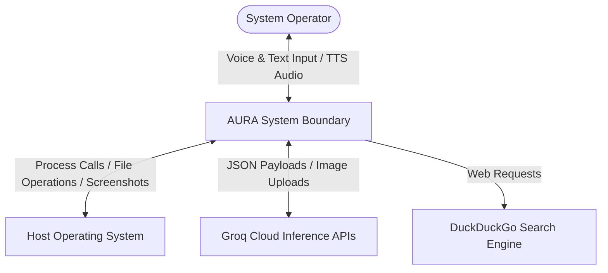

# AURA: TECHNICAL SPECIFICATION & SOFTWARE REQUIREMENTS SPECIFICATION (SRS)

## CHAPTER 5: SOFTWARE ARCHITECTURE & SERVICE DESIGN

---

### 23. System Context Diagram

The System Context Diagram shows how AURA interacts with the user, the host operating system, and external cloud APIs.



---

### 24. Software Architecture

AURA is built on a distributed microservices architecture using local HTTP connections for communication. The core design focuses on **low-coupling** and **single-responsibility principles**. 

```
  ┌────────────────────────────────────────────────────────┐
  │                        GATEWAY                         │
  │                  (Routing Orchestrator)                │
  └──────────────────────────┬─────────────────────────────┘
                             │
            ┌────────────────┴────────────────┐
            ▼                                 ▼
    ┌───────────────┐                 ┌───────────────┐
    │  ASR SERVICE  │                 │  NLP SERVICE  │
    │ (Speech Edge) │                 │ (Intent Cloud)│
    └───────────────┘                 └───────────────┘
            │                                 │
            └────────────────┬────────────────┘
                             │
            ┌────────────────┴────────────────┐
            ▼                                 ▼
    ┌───────────────┐                 ┌───────────────┐
    │ TOOL SERVICE  │                 │VISION SERVICE │
    │  (OS Shell)   │                 │ (Visual Cloud)│
    └───────────────┘                 └───────────────┘
            │                                 │
            └────────────────┬────────────────┘
                             │
                             ▼
                      ┌───────────────┐
                      │  TTS SERVICE  │
                      │ (Speech Synth)│
                      └───────────────┘
```

The Gateway acts as a central coordinator, routing requests through the pipeline sequentially. This architecture isolates resource-intensive tasks (such as running local ML models or handling screenshot conversions) from the web interface, ensuring the UI remains responsive.

---

### 25. Microservice Architecture

Each service is structured as an independent Flask application bound to a specific port on the local loopback interface (`127.0.0.1`).

| Port | Service Name | Responsibility | Dependencies |
| :--- | :--- | :--- | :--- |
| **5000** | **Gateway Service** | Serves static assets, orchestrates routing, manages system state. | `Flask`, `Flask-CORS`, `requests` |
| **5001** | **ASR Service** | Transcribes audio files to text. | `whisper`, `tempfile` |
| **5002** | **NLP Service** | Parses commands into structured JSON. | `groq`, `python-dotenv` |
| **5003** | **Tool Service** | Interacts with the filesystem, system metrics, and apps. | `psutil`, `pyautogui`, `pygetwindow` |
| **5004** | **TTS Service** | Synthesizes text responses into MP3 streams. | `gtts` |
| **5005** | **Vision Service** | Handles visual search and desktop automation. | `groq`, `Pillow`, `pyautogui` |

---

### 26. Component Diagram

The following diagram illustrates the internal components of each microservice and their communication paths.

```mermaid
component-diagram
    package "Gateway Service (:5000)" {
        [Static Server]
        [Pipeline Controller]
    }
    
    package "ASR Service (:5001)" {
        [Whisper Model Loader]
        [Transcribe Handler]
    }
    
    package "NLP Service (:5002)" {
        [Groq Client]
        [Intent Parser]
    }
    
    package "Tool Service (:5003)" {
        [File System API]
        [Process Controller]
        [System Monitor]
    }
    
    package "Vision Service (:5005)" {
        [Screenshot Module]
        [Coordinate Scaler]
        [Visual Automation Engine]
    }
    
    package "TTS Service (:5004)" {
        [gTTS Synthesizer]
        [Audio File Server]
    }
    
    %% Connections
    [Pipeline Controller] -->|WebM Payload| [Transcribe Handler]
    [Pipeline Controller] -->|Text Query| [Intent Parser]
    [Pipeline Controller] -->|Intent JSON| [File System API]
    [Pipeline Controller] -->|Intent JSON| [Visual Automation Engine]
    [Pipeline Controller] -->|Response Text| [gTTS Synthesizer]
    [Static Server] -->|Audio Request| [Audio File Server]
```

---

### 27. Service Responsibilities

#### 1. Gateway Service
- Serves the frontend application files (`index.html`, `styles.css`, `script.js`).
- Manages request parsing and handles pipeline validation.
- Standardizes error messages and manages session states.

#### 2. ASR Service
- Receives raw audio chunks and saves them temporarily to disk.
- Runs local transcription checks using Whisper model weights.
- Deletes temporary audio files immediately after transcription to preserve disk space.

#### 3. NLP Service
- Assembles system prompts containing tool specifications and examples.
- Queries the cloud LLM using temperature controls optimized for parsing tasks.
- Validates that the LLM response is structured as valid JSON.

#### 4. Tool Execution Service
- Interacts with the filesystem using Python's standard library.
- Monitors system resource usage (CPU/RAM).
- Manages running processes (launching/terminating applications).

#### 5. Vision Service
- Captures system screenshots and resizes them to optimize network payloads.
- Sends screenshots to the multimodal model to resolve visual element coordinates.
- Translates coordinates to match the system display settings.

#### 6. Text-to-Speech Service
- Receives output text and queries the gTTS library.
- Saves synthesized speech as a local MP3 file.
- Exposes a static directory to serve audio streams back to the client.
