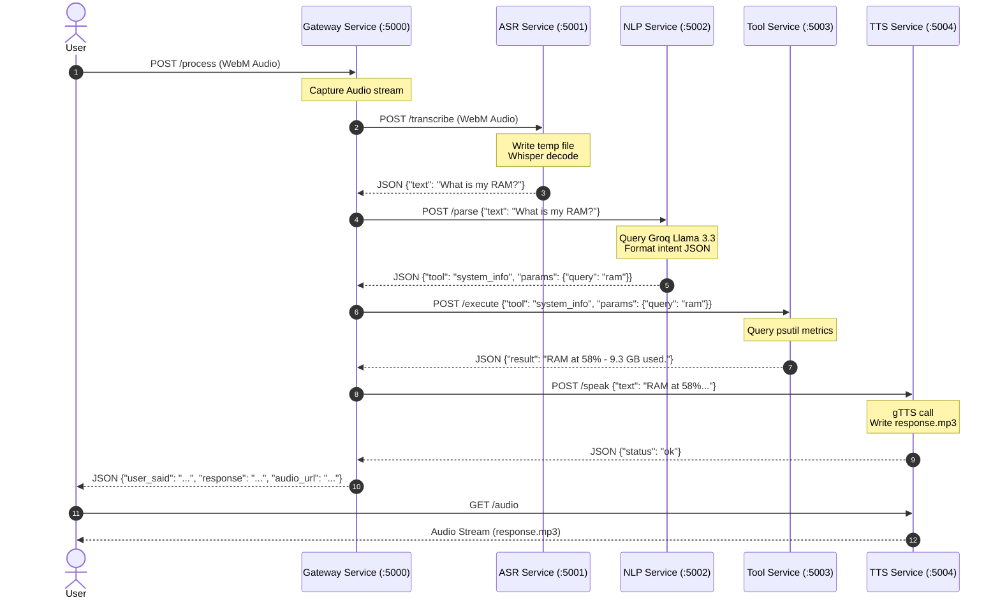

# AURA: TECHNICAL SPECIFICATION & SOFTWARE REQUIREMENTS SPECIFICATION (SRS)

## CHAPTER 6: MICROSERVICE DESIGN SPECIFICATIONS

---

### 28. Gateway Service Design

The Gateway Service serves as the system's entry point and orchestrator. It manages static assets and coordinates the execution flow across backend services.

```
  ┌────────────────────────────────────────────────────────┐
  │                   HTTP POST /process                   │
  └──────────────────────────┬─────────────────────────────┘
                             │
                  [ Read Audio Payload ]
                             │
                             ▼
              ┌─────────────────────────────┐
              │  ASR Service Transcribe     │ (Port 5001)
              └──────────────┬──────────────┘
                             │
                    [ Transcribed Text ]
                             │
                             ▼
              ┌─────────────────────────────┐
              │   NLP Service Parsing       │ (Port 5002)
              └──────────────┬──────────────┘
                             │
                     [ Structured Intent ]
                             │
            ┌────────────────┴────────────────┐
            ▼ (Is Vision Tool?)               ▼ (Is Standard Tool?)
     ┌──────────────┐                  ┌──────────────┐
     │Vision Service│ (Port 5005)      │ Tool Service │ (Port 5003)
     └──────┬───────┘                  └──────┬───────┘
            │                                 │
            └────────────────┬────────────────┘
                             │
                     [ Task Result Text ]
                             │
                             ▼
              ┌─────────────────────────────┐
              │     TTS Service Speak       │ (Port 5004)
              └──────────────┬──────────────┘
                             │
                     [ Audio Stream URL ]
                             │
                             ▼
  ┌────────────────────────────────────────────────────────┐
  │               HTTP 200 Response Payload                │
  └────────────────────────────────────────────────────────┘
```

#### Core Orchestration Logic:
- **Audio Routing:** Accepts binary audio data via `multipart/form-data`, forwards it to the ASR Service, and passes the resulting text to the NLP parser.
- **Intent Dispatching:** Evaluates the parsed intent's target tool. If the tool is listed in `VISION_TOOLS` (e.g., `read_screen`, `click_icon`), the Gateway routes the payload to the Vision Service (`:5005`); otherwise, it dispatches the request to the Tool Service (`:5003/execute`).
- **Response Chaining:** Collects the output text, requests audio synthesis from the TTS Service (`:5004/speak`), and returns a unified JSON response containing the transcription, output text, and audio stream URL.

---

### 29. ASR Service Design

The ASR Service transcribes incoming audio data using a local implementation of the Whisper speech model.

#### Technical Details:
- **Model Size:** Uses the Whisper `base` model (approx. 140 million parameters), which balances transcription speed and accuracy.
- **Temporary Buffering:** Raw audio bytes are written to a temporary file using `tempfile.mktemp()` with a `.webm` extension.
- **Inference Configuration:** transcription calls specify `language="en"` to skip auto-detection delays and reduce latency.
- **Disk Management:** Includes a `finally` block to delete temporary audio files immediately after processing.

---

### 30. NLP Service Design

The NLP Service converts natural language queries into structured JSON command payloads using the Groq API.

#### Technical Details:
- **Model Choice:** Uses `llama-3.3-70b-versatile` due to its reasoning capabilities and low token latency.
- **System Prompt Design:** The system prompt defines all system tools and parameters, provides examples of valid command mappings, and instructs the model to return *only* raw JSON.
- **Output Sanitization:** Strips markdown backticks (e.g., ` ```json `) from responses before parsing them into python dictionaries using `json.loads()`.

---

### 31. Tool Execution Service Design

The Tool Service executes low-level system operations on the host machine using Python's standard library and system integration hooks.

#### Key Implementations:
- **Filesystem Access:** Uses the `os`, `shutil`, and `glob` libraries to perform file operations. Filesystem writes are verified by reading the target file size immediately after writing.
- **Path Resolution:** Implements a lookup sequence to find files. If a file is not found in the working directory, the system searches common user folders (Desktop, Downloads, Documents) before falling back to absolute paths.
- **Window Management:** Uses `pygetwindow` to query active window titles, enabling target windows to be minimized, maximized, or focused by name.
- **Process Orchestration:** Launches applications via `subprocess.Popen` and terminates running processes using `psutil` process iteration.

---

### 32. Vision Service Design

The Vision Service provides screen reading and UI automation capabilities, allowing AURA to interact with application interfaces.

#### Key Implementations:
- **Screenshot Pipeline:** Captures the current display state using `ImageGrab.grab()` and downscales the image to 1280x720 using the Lanczos filter to optimize upload size.
- **Visual Search:** Sends the screenshot and target element name to Groq's multimodal model (`meta-llama/llama-4-scout-17b-16e-instruct`), requesting the element's approximate coordinates as a JSON object: `{"found": true, "x": 123, "y": 456}`.
- **Coordinate Translation:** Scales coordinates returned by the vision model (normalized to a 1280x720 reference frame) to match the host system's actual display resolution:
  $$X_{\text{target}} = X_{\text{model}} \times \left( \frac{\text{Screen Width}}{1280} \right)$$
  $$Y_{\text{target}} = Y_{\text{model}} \times \left( \frac{\text{Screen Height}}{720} \right)$$
- **OS Input Simulation:** Positions the mouse cursor over the target coordinates using `pyautogui.moveTo()` (configured with a 0.4-second movement duration) and executes click events.

---

### 33. Text-to-Speech Service Design

The TTS Service converts text output into audio streams for playback.

#### Technical Details:
- **Synthesis Engine:** Uses the `gtts` library to convert text inputs into speech.
- **Audio Output:** Saves synthesized speech to a local file (`response.mp3`) in the service directory.
- **Audio Serving:** Serves the generated MP3 file to the Gateway via Flask's `send_file()` routing.

---

### 34. Inter-Service Communication Flow

Each service communicates via structured HTTP POST and GET requests. The following sequence diagram illustrates the request routing and execution steps for a voice command.


