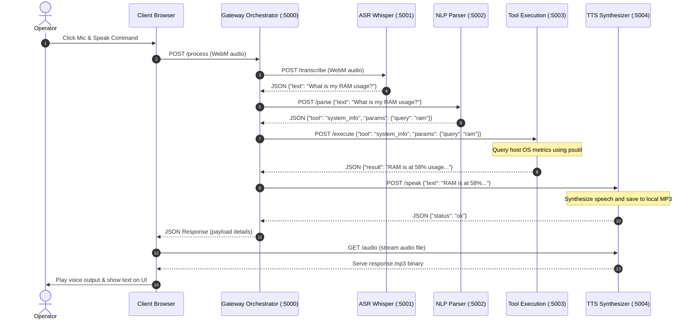
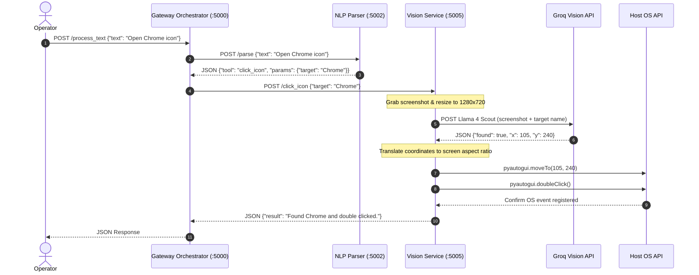
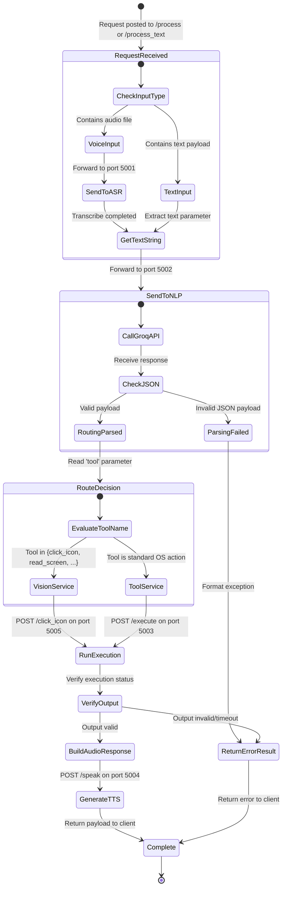

# AURA: TECHNICAL SPECIFICATION & SOFTWARE REQUIREMENTS SPECIFICATION (SRS)

## CHAPTER 8: BEHAVIORAL DIAGRAMS & DEPLOYMENT ARCHITECTURE

This chapter provides behavioral models and architecture diagrams for AURA using Mermaid syntax.

---

### 36. Sequence Diagrams

#### Sequence Diagram SD-1: Voice Processing and Execution Flow
This diagram details the sequence of calls involved in executing a system-level command via voice input.



#### Sequence Diagram SD-2: Vision-Based Click Flow
This diagram illustrates the sequence of calls when the user issues a command to click a visual target on their screen.



---

### 37. Activity Diagrams

#### Activity Diagram AD-1: Gateway Command Validation and Routing
This diagram traces the decision path taken by the Gateway orchestrator when processing user requests.



---

### 38. State Diagrams

#### State Diagram STD-1: System Execution Lifecycle
This state diagram represents the operational states of the Gateway service as it processes requests.

```mermaid
stateDiagram-v2
    [*] --> Idle: System initialized and listening on port 5000
    
    Idle --> Recording: User clicks mic / voice capture active
    Recording --> Transcribing: Audio payload sent to port 5001
    
    Idle --> Parsing: Text prompt received directly via /process_text
    Transcribing --> Parsing: Text transcription successfully returned
    
    Parsing --> Executing: Intent recognized and routed to target service
    Executing --> Verifying: Execution completed; verifying filesystem/OS changes
    
    Verifying --> Synthesizing: Verification successful; text sent to port 5004
    Synthesizing --> Speaking: TTS file generated and streaming to client
    
    Executing --> ExceptionHandled: Timeout / execution exception caught
    Verifying --> ExceptionHandled: Verification check failed
    ExceptionHandled --> Idle: Error displayed in UI
    
    Speaking --> Idle: Audio playback completed
```



---

### 39. Deployment Architecture

AURA is deployed locally on a single host computer, running as a distributed network of microservices that integrate with cloud-hosted inference APIs.

```mermaid
graph TB
    subgraph Host Machine (Local Environment)
        subgraph Frontend Sandbox (Web Browser)
            UI[Web UI Dashboard]
            Mic[Audio Microphone Input]
            Speaker[System Speakers]
        end

        subgraph Service Mesh (Localhost Port Bindings)
            GW[Gateway Service :5000]
            ASR[ASR Service :5001]
            NLP[NLP Service :5002]
            TOOL[Tool Service :5003]
            TTS[TTS Service :5004]
            VIS[Vision Service :5005]
        end

        subgraph Local System Interfaces
            FS[Filesystem Storage]
            OS[Host OS Window Manager]
        end
    end

    subgraph External Infrastructure (WAN)
        Groq[Groq Cloud Inference API]
        DDG[DuckDuckGo Search Engine]
    end

    %% Network Connections
    UI <-->|HTTP / JSON| GW
    Mic -->|Audio Stream| GW
    GW -->|Static Audio URL| UI
    Speaker <-->|MP3 Stream| TTS

    GW <-->|Loopback HTTP| ASR
    GW <-->|Loopback HTTP| NLP
    GW <-->|Loopback HTTP| TOOL
    GW <-->|Loopback HTTP| TTS
    GW <-->|Loopback HTTP| VIS

    TOOL <-->|System Calls / Filesystem IO| FS
    TOOL <-->|pyautogui / subprocess| OS
    VIS <-->|pyautogui / screen grab| OS

    %% Cloud Integration
    NLP <-->|HTTPS API Key| Groq
    VIS <-->|HTTPS API Key| Groq
    TOOL <-->|HTTP requests| DDG
```
